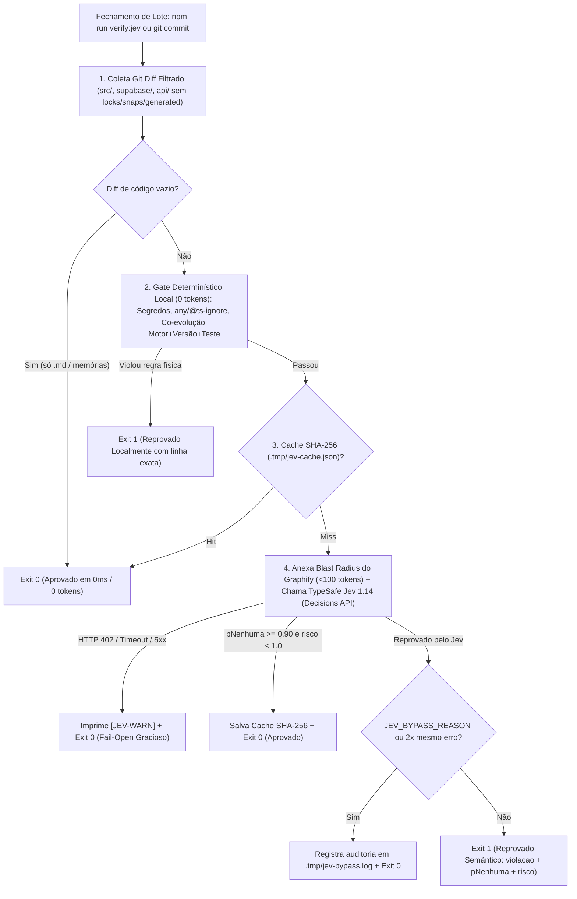

# Arquitetura FinOps Multi-IDE — Graphify + Gate Jev v3 (Síntese Opção A + Opção B)

> **Data de Consolidação**: 2026-11-18  
> **Responsável**: Eliezer Rosa  
> **Status Atual**:
> - **Graphify (`graphifyy 0.9.112` + `tree-sitter-sql`)**: 🟢 **Implantado e Operacional** (`graphify-out/` local em `.gitignore`, hooks/skills integrados ao Claude Code e Antigravity IDE).
> - **Gate Jev v3 (`typesafe/jev-1.14` via `scripts/jev-check.mjs`)**: 📐 **Arquitetura Unificada Homologada** (aguardando autorização final para implementação em `scripts/jev-check.mjs` e ativação nos pipelines de fechamento de lote — atualmente `scripts/jev-check.mjs` permanece em v2 e suspenso por `.roo/rules/10-jev-verificacao.md`).

---

## 1. Visão Geral: Cobertura nas Duas Pontas de Consumo de Tokens

| Ponta do Ciclo Agêntico | Gargalo Original | Ferramenta Coadjuvante | Impacto Direto em Custo/Cota |
| :--- | :--- | :--- | :--- |
| **Entrada (Exploração / Leitura)** | Múltiplos `grep` e leitura integral de arquivos que inflam o contexto e são cobrados repetidamente nos turnos seguintes | **Graphify** *(AST local + SQL, 0 tokens de API)* | Redução líquida medida no uso diário: **45%–65%** (Claude Code com `PreToolUse`), **40%–55%** (Antigravity Orchestrator/Argon), **35%–50%** (modelo único); **70%–85%** em auditorias e análise de impacto. Benchmark local: **593,4×** (~1.225 tokens/query vs ~726.866 no corpus de 751 arquivos). |
| **Saída (Validação Semântica e Regras)** | Uso de modelos caros (Planejador / Opus / Sonnet) para revisar se diffs violaram regras de domínio ou retrabalho pós-erro | **TypeSafe Jev (`jev-1.14`, Gate v3)** *(Decisions API, 1 forward pass, 0 tokens gerados)* | Economia adicional projetada de **+10% a +20%**, permitindo delegar execução a modelos rápidos/baratos com barreira determinística + semântica antes do Planejador revisar (economia combinada esperada: **50%–75%**). |

---

## 2. Os 7 Pilares da Arquitetura Unificada Gate Jev v3 (Opção A + Opção B)

A revisão cruzada entre as análises técnicas (**Opção A** e **Opção B**) identificou quatro armadilhas no desenho inicial do Jev e consolidou **7 regras obrigatórias** para implementação:

1. **Trava Determinística Local Antes da API (Opção A — Custo Zero)**
   - Um `git diff` padrão (`unified=3`) não exibe constantes de versão no topo de arquivos grandes (ex.: `ELIGIBILITY_RULES_VERSION`, `RULES_TEXT_VERSION`).
   - Regras de acoplamento físico definidas em `memories/regras-intencao.md` devem ser barradas **localmente via AST/Regex antes de chamar a API**:
     - Modificou `eligibilityService`, `rankedEligibleService`, `unifiedRotationService` ou `generationService` $\rightarrow$ exigir bump de `ELIGIBILITY_RULES_VERSION` + `RULES_TEXT_VERSION` + toque em `*.test.ts`.
     - Modificou `src/services/**` $\rightarrow$ exigir teste `*.test.ts` correspondente.
     - Proibição de `any`, `@ts-ignore`, `@ts-expect-error`, `eslint-disable` em `src/`.
     - Varredura de segredos (`.env*`, chaves `VITE_*` proibidas).
   - O Jev recebe apenas o julgamento semântico de domínio (ex.: invariantes `M-0` a `M-12` e `I-0` a `I-7`).

2. **Injeção de *Blast Radius* do Graphify no `state` do Jev (Opção B — <100 tokens)**
   - Antes de enviar o payload à Decisions API (`https://openrouter.ai/api/alpha/decisions`), cruzar os símbolos e arquivos alterados com `graphify-out/graph.json` (`graphify affected`) e anexar 3–5 linhas de `impacted_dependents` no campo `state`.
   - Evita que um diff aparentemente inofensivo passe sem que o Jev enxergue contratos quebrados em consumidores externos.

3. **Filtro de Ruído com Pathspec `:(exclude)` e Teto de Payload (Opção A + B)**
   - Coletar o diff filtrado diretamente pelo Git:
     ```bash
     git diff --cached -- src/ supabase/ api/ ":(exclude)*.lock" ":(exclude)*lock.json" ":(exclude)*.snap" ":(exclude)*generated*" ":(exclude)*supabase_types.ts"
     ```
   - **Curto-Circuito de Custo Zero:** Se o diff filtrado estiver vazio (alterações apenas em `*.md`, `memories/`, `.gitignore`, docs), retornar **`Exit 0` imediato** sem chamada HTTP.
   - **Teto de Atenção:** Limitar tamanho máximo do diff por chamada (ou exigir particionamento por módulo/commit) para não diluir a probabilidade `pNenhuma` no `jev-1.14`.

4. **Gatilho Estritamente no Fechamento de Lote — Proibido Hook `Stop` Genérico (Opção A)**
   - **Proibido** rodar Jev em `PostToolUse` de edição individual de arquivo e **proibido** rodar no hook `Stop` genérico do Claude Code sobre a worktree suja: agentes pausam no meio de refatorações para pedir esclarecimentos antes de criar o teste correspondente, causando falsos positivos.
   - Disparar **exclusivamente** na intenção de fechamento do lote:
     - Script explícito `npm run verify:jev`;
     - Hook `PreToolUse` quando o comando for `git commit`;
     - Hook universal `.git/hooks/pre-commit` (cobre todas as IDEs após `tsc -b` + travas locais).

5. **Cache Local SHA-256 em `.tmp/jev-cache.json` (Opção A + B)**
   - Armazenar o hash `SHA-256(regras + diff_filtrado + blast_radius)`.
   - Quando o agente executa `npm run verify:jev` antes do commit, o `.git/hooks/pre-commit` acerta o cache em **0ms e 0 custo** (sem cobrança duplicada).

6. **Degradação Graciosa *Fail-Open* em HTTP 402 / Timeout / 5xx (Opção A)**
   - No `scripts/jev-check.mjs` legado (v2), erros HTTP retornam `process.exit(2)`, bloqueando o `git commit` e gerando loops no agente quando faltam créditos (`HTTP 402`) ou o OpenRouter oscila.
   - No Gate v3, se as travas determinísticas locais e `tsc -b` já passaram, falhas de infraestrutura/rede (`402`, `429`, `502`, `503`, timeout) devem registrar `[JEV-WARN: Bypass de API por indisponibilidade/402 — travas estáticas locais aprovadas]` e retornar **`Exit 0`** para não violar o axioma de commit.

7. **Válvula Anti-Loop Auditável para Falsos Positivos Probabilísticos (Opção B)**
   - Caso um padrão novo legítimo seja reprovado duas vezes consecutivas com a mesma categoria/motivo após tentativa de correção, ou mediante flag explícita `JEV_BYPASS_REASON="..."`, registrar a ocorrência em `.tmp/jev-bypass.log` e retornar **`Exit 0`** para revisão humana em vez de prender o agente em loop infinito de reescrita.

---

## 3. Fluxo do Pipeline Gate Jev v3



---

## 4. Referências Relacionadas
- [`memories/regras-intencao.md`](../regras-intencao.md)
- [`memories/session/governanca-jev-v2-regras-intencao-e-finops-ia.md`](../session/governanca-jev-v2-regras-intencao-e-finops-ia.md)
- [`.roo/rules/10-jev-verificacao.md`](../../.roo/rules/10-jev-verificacao.md)
- [`scripts/jev-check.mjs`](../../scripts/jev-check.mjs)
