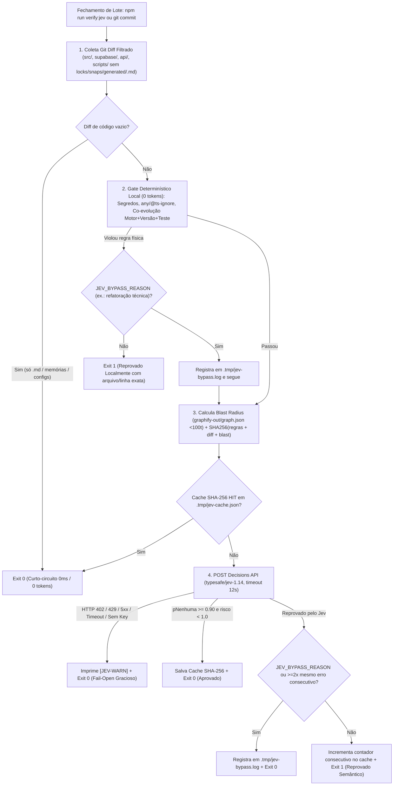

# RFC / Proposta Completa — Arquitetura FinOps Multi-IDE: Graphify + Gate Jev v3

> **Documento para Parecer Técnico (Claude Opus)**  
> **Data**: 2026-11-18  
> **Responsável Epistêmico**: Eliezer Rosa  
> **Repositório**: `rvm-designacoes-unified` (branch `main`, base `0534c9b`)  
> **Status dos Componentes**:
> - **Graphify (`graphifyy 0.9.112` + `tree-sitter-sql==0.3.13` via `uv 0.13.9`)**: 🟢 **Implantado e Operacional** (`graphify-out/` gerado localmente e ignorado via `.gitignore`; hooks/skills instalados no Claude Code e Antigravity IDE).
> - **Gate Jev v3 (`typesafe/jev-1.14` via `scripts/jev-check.mjs`)**: ⏸️ **Aguardando Parecer & Autorização Final** (`scripts/jev-check.mjs` atual permanece no Gate v2 calibrado 30/30 e **suspenso** conforme `.roo/rules/10-jev-verificacao.md`; nenhuma alteração foi aplicada em código ou hooks do Git ainda).

---

## 1. Contexto Executivo: O Problema e as Duas Pontas de Custo

Os agentes de codificação (Claude Code, Antigravity IDE Orchestrator, Cursor, Roo Code) desperdiçam cota/tokens em **duas pontas distintas** de cada tarefa:

| Ponta do Ciclo Agêntico | Gargalo Original | Ferramenta Coadjuvante | Efeito FinOps |
| :--- | :--- | :--- | :--- |
| **1. Entrada (Exploração / Leitura)** | Múltiplos `grep` e abertura integral de arquivos grandes (`WorkbookManager.tsx`, `PublisherSelect.tsx`, `eligibilityService.ts`, etc.), inflando o contexto inicial e multiplicando a cobrança em todos os turnos seguintes | **Graphify** *(AST local + SQL, **0 tokens de API**)* | **Já implantado.** Substitui buscas cegas por subgrafos exatos (`graphify query/explain/affected`, média ~1.225 tokens/consulta vs ~726.866 tokens no corpus de 751 arquivos — benchmark **593,4×**). |
| **2. Saída (Validação de Intenção e Domínio)** | Usar modelos grandes/caros (Planejador / Opus / Sonnet) para revisar diffs ou detectar tardiamente violações de invariantes de negócio (`M-0…M-12`, `I-0…I-7`, segredos, versões do motor) | **TypeSafe Jev (`jev-1.14`, Gate v3)** *(Decisions API, 1 único *forward pass*, **0 tokens de saída gerados**)* | Avalia `{ regras, blast_radius, diff_filtrado }` por probabilidades determinísticas de escolha/risco a frações de centavo, barrando código defeituoso **antes** de acionar o modelo Planejador e viabilizando Execução com modelos rápidos/baratos. |

### Economia Líquida Real Estimada em Sessões Completas
Considerando toda a sessão real (prompt de sistema, leitura obrigatória de `_ESTADO-ATUAL.md`, código, testes e build):

| Ambiente / Tipo de Uso | Economia com **Graphify Ativo** *(Já real)* | Ganho Adicional Projetado com **Gate Jev v3** | Total Combinado Esperado |
| :--- | :---: | :---: | :---: |
| **Claude Code (`PreToolUse` hooks ativos)** | **45% a 65%** | **+10% a +20%** | **~55% a 75%** |
| **Antigravity IDE (Orchestrator / Argon: Planejador + Executor)** | **40% a 55%** | **+10% a +20%** | **~50% a 70%** |
| **Antigravity / IDE em Modelo Único** | **35% a 50%** | **+5% a +15%** | **~45% a 65%** |
| **Auditorias, Diagnóstico de Bugs e Análise de Impacto** | **70% a 85%** | *(foco em leitura)* | **~70% a 85%** |
| **Mudanças pontuais em 1 arquivo já conhecido** | **5% a 15%** | **+0% a +5%** *(trava local gratuita)* | **~5% a 20%** |

---

## 2. O que já Existe no Projeto Hoje

1. **Graphify instalado e integrado (commit `1538b2f`)**:
   - `AGENTS.md`, `.claude/settings.json` (`graphify hook-guard search/read/compact`), `.claude/skills/graphify/`, `.agents/rules/graphify.md`, `.agents/workflows/graphify.md` e `.graphifyignore`.
   - Grafo local gerado com custo `0` de tokens via `GRAPHIFY_BACKEND=none` e `graphify . --code-only` + `graphify cluster-only . --no-label`: **10.903 nós**, **23.044 arestas**, **435 comunidades**.
2. **Verificador Jev v2 já calibrado anteriormente (`scripts/jev-check.mjs`)**:
   - Consome `POST https://openrouter.ai/api/alpha/decisions` com `model: 'typesafe/jev-1.14'`.
   - Limiares calibrados em 6 fixtures × 5 execuções (`30/30` acertos, `100%` precisão — ver `memories/session/governanca-jev-v2-regras-intencao-e-finops-ia.md`): `LIMIAR_NENHUMA = 0.90` e `LIMIAR_RISCO = 1.0`.
   - Regras de negócio enxutas em `memories/regras-intencao.md` (50 linhas, ~600 tokens).
   - **Limitações do v2 atual**: exige path manual de arquivo `.diff`, não lê `git diff --cached`, não filtra ruído (`lock`, `.snap`, `generated`), não possui gate local determinístico antes da API, não enxerga dependentes fora das 3 linhas de contexto (`unified=3`), não tem cache SHA-256, e retorna `process.exit(2)` bloqueante em erros HTTP 402/5xx.

---

## 3. Os 7 Pilares da Proposta Unificada — Gate Jev v3 (Síntese Opção A + Opção B)

A união de duas revisões independentes (**Opção A** e **Opção B**) resolveu as armadilhas de custo, falsos positivos e travamento de esteira:

1. **Pilar 1 — Gate Determinístico Local Pré-API (0 tokens, antes do cache e da rede)** *(Opção A)*
   - Um `git diff` padrão (`unified=3`) oculta constantes no topo do arquivo (ex.: `ELIGIBILITY_RULES_VERSION`). O Jev puro poderia alucinar ou aprovar no escuro.
   - Regras estruturais/físicas de `memories/regras-intencao.md` passam a ser validadas localmente via Regex/AST antes de qualquer hash ou HTTP:
     - **Segredos (`segredos`)**: bloqueia stage de `.env`, `.env.*` (exceto `.env.example`) e linhas adicionadas (`+`) com tokens (`sk-or-v1-`, `VITE_.*(SERVICE_ROLE|OPENROUTER|ZAPI|SECRET|PRIVATE)`).
     - **Estilo / TypeScript (`estilo`)**: bloqueia linhas adicionadas em `src/` (exceto `*.test.ts(x)`) com `@ts-ignore`, `@ts-expect-error`, `eslint-disable`, `: any\b` ou `as any\b` fora de comentários puros.
     - **Co-evolução do Motor (`dominio`)**: ao tocar `src/services/eligibilityService.ts`, `rankedEligibleService.ts`, `unifiedRotationService.ts` ou `generationService.ts`, exige presença de atualização de `ELIGIBILITY_RULES_VERSION`, `RULES_TEXT_VERSION` e pelo menos um arquivo `*.test.ts(x)` no diff (ressalva de refatoração puramente técnica coberta na Descoberta 4 abaixo).
   - A Decisions API recebe **exclusivamente** julgamento semântico de domínio (`M-0…M-12`, `I-0…I-7`).

2. **Pilar 2 — Injeção de *Blast Radius* do Graphify (<100 tokens)** *(Opção B)*
   - Antes de enviar `{ regras, diff }` para `typesafe/jev-1.14`, o script lê `graphify-out/graph.json` em memória (~45ms) e injeta `state.blast_radius` (3 a 5 linhas listando até 10 arquivos/símbolos dependentes dos arquivos alterados).
   - Resolve a cegueira de impacto colateral quando assinaturas/contratos mudam em `src/services/` ou `src/types.ts`.

3. **Pilar 3 — Coleta Filtrada (`:(exclude)`), Curto-Circuito de Docs e Teto de Payload** *(Opção A + B)*
   - Coleta apenas diretórios de código/schema com exclusões nativas do Git:
     ```bash
     git diff --cached --unified=3 -- src/ supabase/ api/ scripts/ ":(exclude)*.lock" ":(exclude)*lock.json" ":(exclude)*.snap" ":(exclude)*generated*" ":(exclude)*supabase_types.ts" ":(exclude)*.md"
     ```
   - **Curto-Circuito 0ms / 0 tokens**: se o diff filtrado vier vazio (ex.: commit tocou apenas `*.md`, `memories/`, `.gitignore`, `.claude/`, `.agents/`), retorna **`Exit 0`** imediatamente sem chamar rede.
   - **Teto de Payload (~14–16 KB)**: se o diff exceder `14.000` chars, resume os blocos `*.test.ts(x)` para `[Testes alterados: <lista>]` e aplica teto duro de `16.000` chars, evitando diluição matemática de `pNenhuma`.

4. **Pilar 4 — Gatilho Estritamente no Fechamento de Lote (Sem Hook `Stop` Genérico)** *(Opção A)*
   - **Proibido** disparar Jev em `PostToolUse` por edição de arquivo e **proibido** disparar no hook `Stop` genérico do Claude Code sobre a *worktree*: agentes pausam no meio de uma refatoração (após editar serviço e antes de criar teste ou perguntar algo ao usuário), gerando falso positivo e loop de custo.
   - Gatilhos permitidos:
     1. Script explícito `npm run verify:jev` (ao concluir um lote lógico);
     2. Hook universal `.git/hooks/pre-commit` (intercepta todo `git commit` em qualquer IDE — Antigravity, Claude Code CLI/VS Code, Cursor, Roo, terminal);
     3. Regra `always_on` no Antigravity (`.agents/rules/jev-gate.md`) e atualização de `.roo/rules/10-jev-verificacao.md`.
   - Pipeline `Fail-Fast` no `pre-commit`: (1) Travas locais + `tsc -b` (0 tokens) $\rightarrow$ (2) `jev-check --staged`.

5. **Pilar 5 — Cache Local `SHA-256` em `.tmp/jev-cache.json`** *(Opção A + B + Refinamento do Usuário)*
   - Chave canônica obrigatória concatenando os três fatores na ordem:
     ```js
     const cacheKey = createHash('sha256')
       .update(`${regrasRaw}\n---DIFF---\n${diffForApi}\n---BLAST---\n${blastRadius}`)
       .digest('hex');
     ```
   - Alterou uma linha em `memories/regras-intencao.md`, no código ou na topologia de dependentes $\rightarrow$ invalidação automática do cache.
   - Rodou `npm run verify:jev` antes do `git commit` $\rightarrow$ o `.git/hooks/pre-commit` dá *Cache Hit* em `0ms` e `0` tokens (sem cobrança dupla).

6. **Pilar 6 — Degradação Graciosa *Fail-Open* em HTTP 402 / Timeout / 5xx** *(Opção A)*
   - No `pre-commit` do Git, qualquer exit code `!= 0` bloqueia o commit. Se `HTTP 402` (falta de créditos OpenRouter), `429`, `>= 500`, `timeout` (12s) ou ausência de `OPENROUTER_API_KEY` retornar `Exit 2`, o agente entra em loop tentando cumprir o axioma de commitar.
   - Solução: se todas as travas determinísticas locais (Etapa 2) passaram, falhas de infraestrutura/rede/créditos emitem `[JEV-WARN: Bypass de API por indisponibilidade/HTTP — travas estáticas locais aprovadas]` e retornam **`Exit 0`**.

7. **Pilar 7 — Válvula Anti-Loop Auditável para Falsos Positivos** *(Opção B)*
   - Suporte a `JEV_BYPASS_REASON="..."` (funciona tanto na trava de co-evolução local quanto na reprovação semântica do Jev) **ou** destravamento automático após `>= 2` rejeições probabilísticas consecutivas idênticas para `(arquivos + violacao)`.
   - Grava trilha auditável em `.tmp/jev-bypass.log` (gitignored) e retorna **`Exit 0`** para revisão humana, impedindo loops destrutivos de reescrita.

---

## 4. Diagrama do Pipeline Gate Jev v3



---

## 5. Cinco Descobertas Técnicas da Revisão Pré-Implementação (Verificadas no Repo Real)

Antes de codificar, inspecionamos o estado real do repositório (`0534c9b`) e identificamos 5 pontos concretos que precisam entrar no pacote:

### Descoberta 1 — Ruído de Bundle Minificado no `graphify-out/graph.json`
Ao ler `graphify-out/graph.json`, os god-nodes do topo eram `vP()` (327 edges), `XFAObject` (217), `ot` (172) e `Ns` (135), originados principalmente de `vercel_fetch.js` (um dump minificado salvo na raiz do projeto) e de arquivos legados (`RmDashboard_aa0414e*.tsx`, `rmService_aa0414e*.ts`).
- **Ação prevista**: adicionar `vercel_fetch.js` e `*_aa0414e*` ao `.graphifyignore` e rodar `graphify update .` (0 tokens) para que o *Blast Radius* reflita apenas o código vivo do RVM (`Publisher`, `WorkbookPart`, `eligibilityService`, etc.).

### Descoberta 2 — Schema Exato de `graphify-out/graph.json` para Cálculo de *Blast Radius* em `<50ms`
Inspeção direta confirmou o formato `node_link_data` (NetworkX 3.7):
- `nodes`: `{ id, label, source_file, source_location, community, _origin }`
- `links`: `{ source, target, relation, source_file, confidence }`
- Um leitor síncrono simples em `scripts/jev-check.mjs` carrega os conjuntos `fileByNodeId`, filtra os `nodeId`s cujo `source_file` está nos arquivos do diff e percorre `links` para retornar os arquivos externos conectados (`source_file` diferente do arquivo editado) com contagem de arestas — sem depender de Python nem de subprocesso `graphify` em cada commit.

### Descoberta 3 — Invalidação Tripla Garantida pelo SHA-256
Como a string de entrada do hash é literalmente:
```js
`${regrasRaw}\n---DIFF---\n${diffForApi}\n---BLAST---\n${blastRadius}`
```
e esse cálculo acontece **após** as Etapas 1, 2 e a extração de `blastRadius`, nenhuma alteração em regra, código ou grafo reutiliza aprovação antiga.

### Descoberta 4 — Salvaguarda para Refatoração Puramente Técnica nos 4 Arquivos do Motor
Em commits como o `6a80ea8` (que adicionou `!availability.exceptionDates.includes(date)` ou ajustes de tipagem), o programador/agente pode tocar `eligibilityService.ts` sem alterar regra canônica `2026-11-17.01`. Se a trava determinística exigir bump de `ELIGIBILITY_RULES_VERSION` de forma cega e sem válvula, travará ajustes técnicos legítimos.
- **Solução**: quando o Gate Determinístico reprovar a co-evolução do motor, ele informa que `JEV_BYPASS_REASON="motivo técnico"` permite registrar o bypass em `.tmp/jev-bypass.log` (preservando a auditoria humana sem forçar bumps falsos de versão).

### Descoberta 5 — Obrigatoriedade de Quebra de Linha `LF` (`\n`) em `.git/hooks/pre-commit` no Windows
No Windows, o Git aciona hooks via Git for Windows (`sh.exe`). O repositório usa `core.autocrlf` que pode converter arquivos para `CRLF` no checkout. Se `.git/hooks/pre-commit` contiver `\r\n`, `sh.exe` aborta com `/bin/sh^M: bad interpreter`.
- **Garantia**: escrever `scripts/git-hooks/pre-commit` e `.git/hooks/pre-commit` com terminação estrita `LF` (e `.gitattributes` `*.sh text eol=lf` / `scripts/git-hooks/* text eol=lf`).

---

## 6. Inventário de Alterações Propostas e Esboço do `scripts/jev-check.mjs` (Gate v3)

### 6.1 Arquivos Afetados quando Aprovado

| Arquivo | Mudança | Finalidade |
| :--- | :--- | :--- |
| `scripts/jev-check.mjs` | Reescrita v2 $\rightarrow$ v3 | Pipeline completo das 5 etapas (Opções A + B). |
| `package.json` | +2 scripts | `"verify:jev": "node scripts/jev-check.mjs --staged"` e `"verify:jev:worktree": "node scripts/jev-check.mjs --worktree"`. |
| `scripts/git-hooks/pre-commit` & `.git/hooks/pre-commit` | Criação (`LF`) | Hook universal: roda `npm run type-check` *(opcional rápido ou direto na etapa)* + `node scripts/jev-check.mjs --staged` em qualquer IDE. |
| `.graphifyignore` | +2 exclusões | `vercel_fetch.js` e `*_aa0414e*` (+ rebuild `graphify update .`). |
| `.agents/rules/jev-gate.md` | Criação (`always_on`) | Integra verificação no fechamento de lote do Antigravity IDE / Orchestrator. |
| `.roo/rules/10-jev-verificacao.md` & `memories/regras-intencao.md` | Atualização de status | Remove aviso de "SUSPENSO" e documenta o fluxo oficial do Gate Jev v3. |

*(Obs.: `.claude/settings.json` mantém apenas hooks do Graphify; **não** adiciona hook `Stop` genérico, pois o `.git/hooks/pre-commit` já intercepta todos os `git commit` do Claude Code com deduplicação via cache SHA-256).*

### 6.2 Especificação Estruturada da Lógica do `scripts/jev-check.mjs` (v3)

```js
// Resumo executável das 5 etapas do Gate Jev v3:
// CLI: node scripts/jev-check.mjs [--staged | --worktree | <diffPath> [rulesPath]]

// ETAPA 1: Coleta e Filtro
// - Modo git (--staged default se sem arquivo):
//   - nameOnly = git diff [--cached|HEAD] --name-only
//   - Verifica se algum arquivo em nameOnly casa com /(^|\/)\.env(\.|$)/ && !/\.env\.example$/ -> Exit 1 (segredos)
//   - diffFiltered = git diff [--cached|HEAD] --unified=3 -- src/ supabase/ api/ scripts/ \
//       ":(exclude)*.lock" ":(exclude)*lock.json" ":(exclude)*.snap" ":(exclude)*generated*" ":(exclude)*supabase_types.ts" ":(exclude)*.md"
//   - Se diffFiltered.trim() === '' -> "[JEV-GATE v3] Curto-circuito (0ms / 0 tokens)" -> Exit 0

// ETAPA 2: Gate Determinístico Local (0 tokens, antes do cache e da API)
// - Parseia linhas adicionadas ('+' excluindo '+++') por arquivo do diff:
//   2a) Segredos nas linhas '+' (sk-or-v1-, VITE_.*SERVICE_ROLE|OPENROUTER|ZAPI|SECRET|PRIVATE) -> Exit 1 (sem bypass se vazar segredo!)
//   2b) Estilo em src/** (exceto *.test.ts/tsx, ignorando linhas de comentário // ou /*):
//       /@ts-ignore|@ts-expect-error|eslint-disable|:\s*any\b|\bas\s+any\b/
//       Se falhar (e sem JEV_BYPASS_REASON) -> Exit 1 com arquivo + trecho exato
//   2c) Co-evolução do Motor (eligibilityService|rankedEligibleService|unifiedRotationService|generationService):
//       Exige alteração em ELIGIBILITY_RULES_VERSION, RULES_TEXT_VERSION e >=1 arquivo *.test.ts(x)
//       Se falhar (e sem JEV_BYPASS_REASON) -> Exit 1 indicando o item faltante
//   *Nota: Se passou por JEV_BYPASS_REASON na etapa 2b/2c, grava em .tmp/jev-bypass.log

// ETAPA 3: Blast Radius (Graphify) + Teto de Diff + Cache SHA-256
// - blastRadius = queryGraphBlastRadius('graphify-out/graph.json', changedFiles, maxDeps=10)
// - diffForApi = compactAndCapDiff(diffFiltered, { maxBeforeTestStrip: 14000, hardCap: 16000 })
// - cacheKey = sha256(`${regrasRaw}\n---DIFF---\n${diffForApi}\n---BLAST---\n${blastRadius}`)
// - Se cache.entries[cacheKey]?.aprovado === true -> "Cache SHA-256 HIT" -> Exit 0

// ETAPA 4: Decisions API (typesafe/jev-1.14, timeout 12s)
// - Se !OPENROUTER_API_KEY -> [JEV-WARN: key ausente] -> Exit 0
// - POST https://openrouter.ai/api/alpha/decisions com state: { regras: regrasRaw, blast_radius: blastRadius, diff: diffForApi }
// - Se erro de rede / timeout / status in [402, 429, >=500] -> [JEV-WARN: Fail-open] -> Exit 0

// ETAPA 5: Decisão (LIMIAR_NENHUMA = 0.90, LIMIAR_RISCO = 1.0) + Válvula Anti-Loop
// - aprovado = pNenhuma >= 0.90 && risco < 1.0
// - Se aprovado: salva cache.entries[cacheKey] = { aprovado: true, ts }, limpa streak -> Exit 0
// - Se reprovado:
//   - streakKey = sha256(changedFiles.sort().join('|') + '::' + violacao)
//   - Incrementa streak em .tmp/jev-cache.json
//   - Se JEV_BYPASS_REASON OU streak >= 2 -> grava .tmp/jev-bypass.log + [JEV-WARN] -> Exit 0
//   - Senão -> Exit 1
```

---

## 7. Pontos Específicos para o Parecer do Claude Opus

Solicita-se que o **Claude Opus** avalie criticamente os 5 pontos abaixo antes de autorizarmos a escrita final:

1. **Impacto de `state.blast_radius` na Calibração `v2` (`pNenhuma >= 0.90`, `risco < 1.0`)**:
   - Os limiares `0.90` / `1.0` foram calibrados originalmente enviando apenas `{ regras, diff }` para `typesafe/jev-1.14`. Inserir `blast_radius` no `state` pode alterar levemente a distribuição de probabilidade de `risco`? Convém re-rodar as 6 fixtures de `_jev_calibrate.mjs` com `blast_radius` populado após implementar?
2. **Estratégia de `tsc -b` no Hook `pre-commit`**:
   - Devemos colocar `npm run type-check` (`tsc -b`) dentro do `.git/hooks/pre-commit` antes de `node scripts/jev-check.mjs --staged` (adicionando ~3–4s em todo commit que toque código, inclusive se você já rodou antes), **ou** deixá-lo apenas se houver arquivos `.ts/.tsx` modificados?
3. **Truncamento Inteligente vs. Risco de Falsos Positivos em Diffs > 16 KB**:
   - Quando um diff legítimo passar de 16.000 chars mesmo após omitir o corpo de `*.test.ts(x)`, é melhor **cortar/truncar** o diff com aviso `[TRUNCADO]` ou **pular a API com `[JEV-WARN]`** (evitando que o Jev reprove um diff cortado no meio como sintaticamente estranho)?
4. **Remoção de `scripts/jev-check.mjs` de `:(exclude)` vs. Auto-inspeção**:
   - Como o comando proposto inclui `scripts/` no `git diff --cached -- src/ supabase/ api/ scripts/`, alterações no próprio `jev-check.mjs` também passarão pelo gate. É desejável ou `scripts/` contém scripts pontuais ad-hoc demais (ex.: `scripts/test_*.ts` com `: any` legado) que deveriam ficar fora da regra rígida de `estilo`? *(Obs.: a regra em `regras-intencao.md` linha 30 restringe `any`/`@ts-ignore` especificamente "em `src/`", o que já está respeitado na Etapa 2b).*
5. **Reaproveitamento entre `RVM Designações` e `idd-ide`**:
   - Há algo nesta especificação que conflite com a futura extensão de governança do projeto irmão `C:\IDE IDD Claude-VS Code\idd-ide`?
