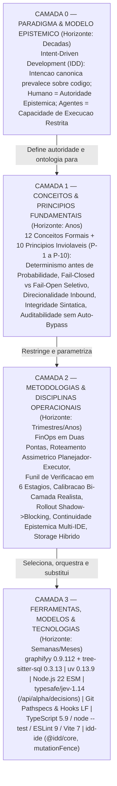
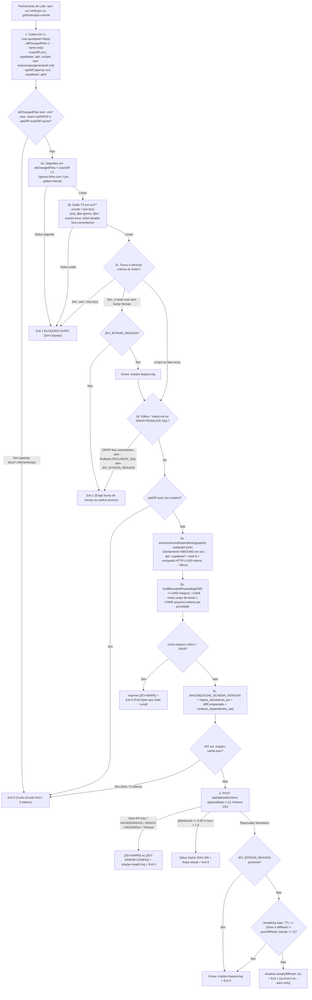

# Dossiê Arquitetural Completo — Governança Epistêmica, FinOps Multi-IDE e Pipeline Graphify + Gate Jev v3.2

> **Documento Único Exaustivo para Parecer Técnico Final — Claude Fable 5.2**  
> **Data de Consolidação**: `2026-11-19` *(revisão profunda v3.2 sobre base v3.1 de 2026-11-18)*  
> **Responsável Epistêmico**: `Eliezer Rosa`  
> **Repositório Primário**: `rvm-designacoes-unified` (branch `main`, base `f0e1ade`, suíte `158/158` testes passando; `npm run build` limpo; **`npm run type-check` possui `155` erros TS pré-existentes** — ver §4.2.C)  
> **Projeto Irmão Convergente**: `C:\IDE IDD Claude-VS Code\idd-ide`  
> **Genealogia Consolidada neste Dossiê**:  
> 1. Síntese Opção A + Opção B ([`memories/repo/arquitetura-finops-graphify-jev-v3.md`](arquitetura-finops-graphify-jev-v3.md));  
> 2. Parecer Empírico Argon High (Seção 8 do documento v3: 4 ajustes empíricos);  
> 3. Parecer Técnico Neon (v3.1: 5 refinamentos críticos);  
> 4. **Auditoria Profunda Neon Extra / XHigh (v3.2 — 2026-11-19)**: **8 achados empíricos adicionais** verificados diretamente via `tsc -b --verbose`, inspeção de `supabase/migrations/`, simulação do extrator *inbound* em 7 arquivos reais, medição dos 4 commits de código mais recentes e leitura integral de `idd-ide/cli/src/commands/verify.ts`.  
> **Status Executável Atual**:  
> - **Graphify (`graphifyy 0.9.112` + `tree-sitter-sql==0.3.13` via `uv 0.13.9`)**: 🟢 **Ativo e Higienizado localmente** em `graphify-out/` (ignorado via `.gitignore`, `4.628` nós, `9.766` arestas, `310` comunidades — redução de `-57,6%` de ruído frente aos `10.903` nós iniciais).  
> - **Gate Jev (`scripts/jev-check.mjs`)**: ⏸️ **Em estado v2 suspenso** conforme [`.roo/rules/10-jev-verificacao.md`](../../.roo/rules/10-jev-verificacao.md) e [`memories/regras-intencao.md`](../regras-intencao.md). **Nenhuma linha de código ou hook do Git foi modificada**, aguardando o parecer do **Claude Fable 5.2** e autorização final do Responsável Epistêmico.

---

## Sumário Executivo

1. [Parte I — Taxonomia Ontológica de 4 Camadas (Separação Rigorosa)](#parte-i--taxonomia-ontológica-de-4-camadas-separação-rigorosa)
2. [Parte II — Camadas 0 e 1: Paradigma, Conceitos e Princípios Fundamentais](#parte-ii--camadas-0-e-1-paradigma-conceitos-e-princípios-fundamentais)
3. [Parte III — Camada 2: Metodologias, Disciplinas e Processos Operacionais](#parte-iii--camada-2-metodologias-disciplinas-e-processos-operacionais)
4. [Parte IV — Camada 3: Ferramentas, Modelos e Tecnologias (Especificação Concreta e Intercambiabilidade)](#parte-iv--camada-3-ferramentas-modelos-e-tecnologias-especificação-concreta-e-intercambiabilidade)
5. [Parte V — Consolidação das Auditorias e Resolução Definitiva dos 5 Pontos Críticos](#parte-v--consolidação-das-auditorias-e-resolução-definitiva-dos-5-pontos-críticos)
6. [Parte VI — Proposta Completa de Implementação (Spec Executável v3.1 + Justificativas)](#parte-vi--proposta-completa-de-implementação-spec-executável-v31--justificativas)
7. [Parte VII — Questionário Arquitetural para Parecer Final do Claude Fable 5.2](#parte-vii--questionário-arquitetural-para-parecer-final-do-claude-fable-52)

---

# Parte I — Taxonomia Ontológica de 4 Camadas (Separação Rigorosa)

## 1.1 Por que Separar Rigorosamente Paradigma, Conceitos/Princípios, Metodologias e Ferramentas

Em arquiteturas assistidas por agentes de IA, o erro estrutural mais frequente é o **colapso ontológico**: tratar uma tecnologia transitória como se fosse um princípio arquitetural, ou confundir uma disciplina operacional com um script específico. Quando esse colapso ocorre:

1. **Vendor Lock-in Disfarçado de Arquitetura**: Se o time assume que *"Governança = `scripts/jev-check.mjs` chamando `typesafe/jev-1.14` na OpenRouter"*, qualquer mudança na API alpha da OpenRouter (`HTTP 402`, depreciação de endpoint, alteração de formato) paralisa ou invalida a disciplina inteira. Quando se separa que **o Princípio** é *"Avaliação Semântica de Baixo Custo Antes da Escalação para Modelo Frontier"*, que **a Metodologia** é *"Funil em Camadas Determinístico → Topológico → Semântico em Fronteira de Lote"*, e que **a Tecnologia** atual é *"`typesafe/jev-1.14` via `openrouter.ai/api/alpha/decisions`"*, a ferramenta torna-se um adaptador substituível sem alterar a doutrina.
2. **Mimetismo de Sintoma (Confundir Artefato com Garantia)**: Instalar o binário `graphify` sem a disciplina de higienização de bundles minificados e sem distinguir direcionalidade de arestas gera ruído (`57,6%` dos nós do grafo inicial eram `pdf.worker.min.mjs` e `vercel_fetch.js`). Não basta adotar uma ferramenta: ela precisa servir a um **conceito formal** (*Raio de Impacto Direcionado Inbound*) governado por uma **metodologia** (*Curadoria e Poda de Grafo + Validação Empírica*).
3. **Alinhamento entre Repositórios Irmãos (`rvm-designacoes-unified` e `idd-ide`)**: O projeto `C:\Antigravity - RVM Designações\rvm-designacoes-unified` e o projeto `C:\IDE IDD Claude-VS Code\idd-ide` compartilham os mesmos **Camada 0 (Paradigma IDD)** e **Camada 1 (Conceitos e Princípios)**, convergem na **Camada 2 (Metodologias)**, mas operam hoje com ferramentas parciais distintas na **Camada 3** (`scripts/jev-check.mjs` + `graphifyy` de um lado; `@idd/core` + `cli/src/lib/mutationFence.ts` + `astGraph.ts` do outro). Sem essa separação de camadas, os dois projetos duplicam mecanismos ou conflitam em hooks (como o conflito descoberto entre `core.hooksPath` e o método `writeHook` de `idd-ide/cli/src/commands/init.ts`).

---

## 1.2 Arquitetura em Camadas e Lei de Inversão de Estabilidade

As quatro camadas obedecem a uma **Lei de Inversão de Estabilidade**: camadas superiores têm horizonte de permanência medido em **décadas ou anos** e raramente mudam; camadas inferiores têm horizonte medido em **trimestres, meses ou semanas** e devem ser projetadas para substituição com atrito zero. As dependências fluem **de baixo para cima** (a tecnologia materializa a metodologia, que operacionaliza princípios, que realizam o paradigma — nunca o contrário).



---

## 1.3 Tabela Ontológica Comparativa Completa

| Camada | Natureza Epistêmica | Pergunta que Responde | Horizonte de Estabilidade | Critério de Substituição | O que É | O que NÃO É | Manifestação Concreta em RVM / `idd-ide` |
| :--- | :--- | :--- | :--- | :--- | :--- | :--- | :--- |
| **Camada 0: Paradigma** | Filosofia de engenharia e distribuição de autoridade | *Quem detém a verdade e o que governa o software?* | **Décadas** | Ruptura de modelo computacional de desenvolvimento de software | **IDD (Intent-Driven Development)** — primazia normativa da intenção declarada sobre código e sobre IA | Não é um framework NPM, não é prompt engineering, não é metodologia ágil | `.agents/workflows/motor-invariants.intent.md`, `memories/regras-intencao.md`, `idd-ide/project.intent.yaml` |
| **Camada 1: Conceitos & Princípios** | Invariantes formais, vocabulário ontológico e leis de conservação | *Quais propriedades formais devem valer sempre, independentemente do processo?* | **Anos** | Falsificação matemática/empírica da invariante ou mudança de paradigma | Definições precisas (*Drift Semântico*, *Inbound Blast Radius*, *Mutation Fence*) e leis `P-1…P-10` | Não são passos procedimentais de checklist nem flags de CLI | Separação `Fail-Closed` (segredos/`any`/testes) vs `Fail-Open` (HTTP 402/5xx); `SHA256` quádruplo; `Inbound != Outbound` |
| **Camada 2: Metodologias & Disciplinas** | Processos repetíveis, rituais de calibração, economia e fluxo de trabalho | *Como humanos e agentes operam no dia a dia para cumprir os princípios?* | **Trimestres a Anos** | Descoberta de fluxo mais econômico, mais seguro ou com menor fricção cognitiva | FinOps em Duas Pontas, Plan-Execute Assimétrico, Funil de 6 Estágios, Calibração em 2 Camadas, Shadow $\rightarrow$ Blocking, Axioma Multi-IDE | Não está presa a um editor específico (VS Code, Cursor, Claude Code, Antigravity) nem a um provedor de LLM | Redução pré-sessão via subgrafo, gatilho estrito no fechamento de lote, atualização canônica `_ESTADO-ATUAL.md`, Storage `C:\` vs OneDrive `+U -P` |
| **Camada 3: Ferramentas & Tecnologias** | Artefatos executáveis, bibliotecas, protocolos, modelos e formatos concretos | *Qual implementação concreta executa hoje cada etapa da metodologia?* | **Semanas a Meses** | Aparecimento de alternativa mais rápida, mais barata, mais confiável ou mudança de API | `graphifyy 0.9.112`, `tree-sitter-sql`, `typesafe/jev-1.14`, OpenRouter Decisions API, `Node 22 ESM`, `tsc 5.9`, `vitest`/`node --test`, `.git/hooks/pre-commit` | Não é a fonte da regra de negócio e não pode impor limitações conceituais permanentes (ex.: `tsc -b` lento dita exclusão do hook, não abandono de tipagem) | `graphify-out/graph.json`, `scripts/jev-check.mjs`, `.claude/settings.json`, `.agents/rules/graphify.md`, `cli/src/lib/mutationFence.ts` |

---

# Parte II — Camadas 0 e 1: Paradigma, Conceitos e Princípios Fundamentais

## 2.1 Camada 0 — O Paradigma Central: IDD (Intent-Driven Development)

### Tese Central do IDD
Na engenharia pré-IA, escrever código era caro e lento; por isso, metodologias clássicas centravam-se em gerenciar a escassez de digitação e a coordenação humana em torno do código-fonte como artefato primário. Com agentes de codificação (Claude Code, Gemini/Argon/Neon no Antigravity Orchestrator, Cursor, Roo Code), o custo marginal de gerar centenas de linhas de TypeScript caiu próximo de zero.

Essa abundância inverteu o gargalo: **o novo risco dominante é a geração ultrarrápida de código sintaticamente válido, tipado e localmente plausível que viola silenciosamente regras sutis de negócio (*drift semântico*), explode custos de contexto (*token bloat*) ou rompe invariantes arquiteturais entre arquivos distantes**.

O **Intent-Driven Development (IDD)** estabelece quatro postulados paradigmáticos:

1. **Hierarquia Normativa Explícita**: Documentos de intenção canônica (`.intent.md`, `project.intent.yaml`, `memories/regras-intencao.md`) são a **fonte primária de verdade**; código-fonte e testes são **projeções executáveis derivadas**. Em caso de conflito entre o código e a intenção declarada, **o código está errado**, nunca a intenção.
2. **Separação entre Autoridade Epistêmica e Capacidade de Execução**:
   - **Autoridade Epistêmica** pertence exclusivamente ao humano (**Responsável Epistêmico**, Eliezer Rosa): somente o humano cria/altera invariantes (`M-0…M-12`, `I-0…I-7`), muda o ciclo de vida (`exploratory` $\rightarrow$ `consolidation` $\rightarrow$ `production` em `idd-ide`) ou autoriza exceções formais (*waivers*).
   - **Capacidade de Execução** pertence a múltiplos agentes e modelos heterogêneos: planejadores pesados, executores rápidos e auditores automáticos. Agentes não têm legitimidade para relaxar regras silenciosamente (ex.: converter um gate booleano em score aditivo ou remover validação bidirecional).
3. **Verificação Antecipada como Fronteira de Custo e Segurança**: Toda mutação proposta por agente deve passar por cerca de conformidade antes de contaminar o histórico do repositório ou exigir inspeção cara linha a linha por modelos frontier.
4. **Independência de Agente / Memória Epistêmica Persistente**: A inteligência operacional não reside na janela efêmera de contexto de um chat ou de uma IDE específica, mas no estado canônico versionado do projeto.

### Comparação Formal de Paradigmas

| Dimensão | **IDD (Intent-Driven Development)** | **TDD (Test-Driven Development)** | **BDD (Behavior-Driven Development)** | **DDD (Domain-Driven Design)** | **SDD (Spec-Driven Development)** |
| :--- | :--- | :--- | :--- | :--- | :--- |
| **Artefato Fonte de Verdade** | Especificação de Intenção & Invariantes (`.intent.yaml`, `.intent.md`, `regras-intencao.md`) | Suíte de testes unitários (*Red-Green-Refactor*) | Cenários comportamentais (*Given-When-Then* / Gherkin) | Modelo Ubíquo + Bounded Contexts + Agregados | Especificação funcional/técnica formal (*RFC/Spec*) |
| **Autoridade em Conflito Código × Regra** | **Intenção vence sempre** (explicitado no cabeçalho canônico e travas de alteração) | Teste vence código local, mas testes podem ser reescritos com bugs por agentes | Cenário vence implementação se coberto por steps | Modelo conceitual orienta refatoração humana | Spec orienta revisão humana de PR |
| **O que Detecta Mal em Agentes Autônomos** | N/A — desenhado especificamente para agentes (impede reescrever regra, silenciar erro ou vazar segredo) | Agente altera código **e** relaxa asserções do teste simultaneamente para "ficar verde" | Não cobre invariantes internas de arquitetura (`any`, bounded contexts, locks, custos) | Não impõe gates determinísticos nem semânticos por commit em tempo real | Specs longas inflam prompt inicial sem poda topológica (custo quadrático em agentes) |
| **Mecanismo de Verificação** | Híbrido: **Determinístico** (AST, Tipos, Regex, Grafos `WRITES`) + **Semântico** (Decision API / Review) | Execução determinística de asserções | Execução de steps de aceitação | Revisão humana de design / linters modulares | Leitura comparativa humana ou LLM longo |
| **Convergência com Outros Paradigmas** | **Envolve TDD, DDD e SDD**: exige `*.test.ts` (TDD), respeita Bounded Contexts (DDD) e usa specs enxutas (~600 tokens) + grafo AST | Subconjunto de evidência executável dentro do IDD | Camada de aceitação de usuário | Linguagem ubíqua (`ubiquitous-dictionary.json` no `idd-ide`) | Evolução operacional de specs curtas e versionadas |

---

## 2.2 Camada 1 — Glossário Ontológico: Os 12 Conceitos Fundamentais

Cada termo utilizado nesta arquitetura possui significado técnico preciso:

### 1. Intenção Canônica (*Canonical Intent*)
- **Definição**: Enunciado normativo explícito, versionado e legível por humanos e máquinas que define *o que o sistema deve garantir e o que é proibido fazer*, com precedência formal sobre o código-fonte.
- **No ecossistema**: `.agents/workflows/motor-invariants.intent.md` (versão de regras `2026-11-17.01`), `memories/regras-intencao.md` (50 linhas, ~600 tokens) e `C:\IDE IDD Claude-VS Code\idd-ide\project.intent.yaml` (`global_constraints`: `G-ARCH-01`, `G-ARCH-02`, `G-SEC-01`).

### 2. Invariante Estrutural/Física vs. Invariante Semântica/de Domínio
- **Invariante Estrutural/Física**: Propriedade decidível em tempo polinomial sobre sintaxe, AST, caminhos de arquivo, tipos ou padrões lexicais sem necessidade de interpretar a intenção semântica de negócio. *Exemplos*: ausência de arquivos `.env` no stage; ausência de credenciais; ausência de `: any`, `as any`, `@ts-ignore`, `@ts-expect-error`, `eslint-disable` em `src/`; exigência de que toques em 4 serviços críticos do motor sejam acompanhados de teste unitário e bump de versão.
- **Invariante Semântica/de Domínio**: Propriedade cujo descumprimento pode estar sintaticamente perfeito e 100% bem-tipado em TypeScript, exigindo leitura contextual de significado entre regras e diff. *Exemplos*: trocar faixas lexicográficas estritas (`M-0`) por pontuação somada ponderada; quebrar ortogonalidade entre `is_congregated` e `field_service_status` (`I-0`); remover verificação bidirecional de parentesco/gênero (`2026-10-15.01`); disparar S-89 via cron automático em vez do botão "Publicar".

### 3. Drift Semântico (*Semantic Drift*)
- **Definição**: Desvio gradual ou pontual pelo qual o código passa a implementar um modelo mental diferente da Intenção Canônica enquanto continua compilando e eventualmente passando testes desatualizados ou ajustados pelo próprio agente.
- **Exemplo clássico prevenido**: Um agente corrige um erro de ordenação adicionando `+ bonus` numérico para desempatar candidatos em `rankedEligibleService.ts` — código limpo, zero erros de `tsc`, testes locais ajustados — mas violando frontalmente `M-0` (*"Não existe score numérico"*).

### 4. Cerca de Mutação (*Mutation Fence*)
- **Definição Formal (`idd-ide`)**: Mecanismo estático baseado em AST que extrai todas as mutações de estado (arestas tipadas `WRITES` em `this.campo` ou propriedades alvo) de um método/classe e as confronta com o conjunto autorizado (`allowedFields`) e proibido (`readOnlyFields`) declarados no contrato `.intent.yaml`.
- **Implementação de referência**: [`verificarCercaMutacao`](file:///C:/IDE%20IDD%20Claude-VS%20Code/idd-ide/cli/src/lib/mutationFence.ts) detectando 3 classes de violação formal: `INV-ENCAP-01` (mutação de campo read-only), `INV-UI-04` (mutação fora de `allowed_fields`) e `INV-UI-05` (mutação dinâmica não verificável estaticamente).

### 5. Grafo de Conhecimento Estrutural (*AST + SQL Knowledge Graph*)
- **Definição**: Representação formal em grafo $G = (V, E)$ onde vértices $V$ são módulos, arquivos, classes, funções, tabelas SQL e contratos, e arestas $E$ são relações tipadas (`imports_from`, `imports`, `calls`, `reads_from`, `writes_to`, `inherits`, `implements`, `triggers`, etc.) extraídas de forma **100% determinística via AST**, com **0 tokens de LLM**.

### 6. Raio de Impacto Direcionado (*Inbound Blast Radius* vs. *Outbound Dependencies*)
- **Definição Matemática**: Dado um subconjunto de arquivos alterados $F \subseteq \text{Files}(G)$ e seus nós associados $V_F = \{ v \in V \mid \text{file}(v) \in F \}$:
  $$\text{Inbound}(F) = \{ (\text{file}(u), \text{count}) \mid (u \to v) \in E,\; v \in V_F,\; \text{file}(u) \notin F \}$$
  $$\text{Outbound}(F) = \{ (\text{file}(v), \text{count}) \mid (u \to v) \in E,\; u \in V_F,\; \text{file}(v) \notin F \}$$
- **Diferença vital**: $\text{Inbound}(F)$ lista **quem chama/importa os arquivos editados** (quem sofre o impacto colateral se assinaturas ou invariantes de $F$ mudarem — verdadeiro *blast radius*). $\text{Outbound}(F)$ lista apenas **o que $F$ importa** (ex.: `src/types.ts`). Uma travessia não-direcionada confunde os dois e polui o contexto semântico enviado ao verificador.

### 7. Economia de Tokens em Duas Pontas (*Two-Ended Agentic Token Economics*)
- **Definição**: Princípio econômico segundo o qual o custo total de uma sessão agêntica é determinado multiplicativamente pela **Ponta de Entrada** (volume do contexto inicial acumulado a cada turno) e pela **Ponta de Saída** (taxa de defeito tardio que força re-ciclos de correção em modelos caros). Otimizar apenas uma ponta preserva o gargalo da outra.

### 8. Avaliação de Decisão em Passo Único (*Single Forward-Pass Decision Scoring*)
- **Definição**: Uso de um classificador discriminativo / *Decisions API* que recebe `{ regras, contexto_topologico, diff }` e avalia perguntas estruturadas (`noul` booleano contínuo, `choice` categórico com distribuição de probabilidade, `score` esperado contínuo) em um único *forward pass*, emitindo **0 tokens de texto livre explicativo** e permitindo calibração quantitativa rigorosa de limiares ($P(\text{nenhuma}), \mathbb{E}[\text{risco}]$).

### 9. *Fail-Closed* vs. *Fail-Open* Seletivo
- **Fail-Closed**: Em falha ou incerteza, **bloqueia a operação**. Obrigatório em segurança (segredos), tipagem/integridade (`any`/`@ts-ignore`), cobertura mínima (`*.test.ts` ao alterar motor) e proteções destrutivas (`DROP TABLE`).
- **Fail-Open Seletivo**: Em falha de serviço externo remoto não controlável (ex.: HTTP `402` sem créditos na OpenRouter, timeout de rede, HTTP `429`/`5xx`), **depois** que toda a camada determinística local já aprovou integralmente o diff, emite alerta explícito e **não paralisa o fluxo de trabalho local** (`Exit 0`), evitando que oscilação de API externa prenda agentes em loops de tentativa e desperdice muito mais cota no orquestrador do que a verificação economizaria.

### 10. Idempotência Criptográfica (*Content-Addressed Verification*)
- **Definição**: Propriedade pela qual um resultado de verificação aprovado é indexado pelo hash criptográfico completo de todos os determinantes de validade:
  $$H = \text{SHA-256}(\text{CacheSchemaVersion} \parallel \text{RegrasIntenção} \parallel \text{DiffCompactado} \parallel \text{ContextoDependentesAST})$$
  Garante tempo de verificação `0ms` e custo `0` tokens entre `npm run verify:jev` e `git commit`, com **invalidação automática garantida** se qualquer um dos quatro fatores mudar.

### 11. Válvula de Escape Auditável (*Auditable Waiver & Safe Anti-Loop*)
- **Definição**: Mecanismo controlado para impedir dois extremos destrutivos: rigidez cega que trava refatorações legítimas (falsos positivos) vs. permissividade silenciosa que anula o gate. Exige distinção formal entre **Waiver Explícito Declarado** (com motivo auditável gravado em log) e **Anti-Loop Probabilístico** (somente para tentativas com mutação efetiva de diff dentro de janela temporal curta — nunca para re-submissão preguiçosa do mesmo diff).

### 12. Continuidade Epistêmica Multi-IDE (*Cross-IDE Epistemic Continuity*)
- **Definição**: Capacidade de qualquer modelo ou IDE (Claude Code CLI, Antigravity Orchestrator, VS Code, Cursor, Roo Code) assumir o trabalho instantaneamente sem perda de invariantes ou contexto, sustentada pela persistência canônica versionada + estado de árvore Git limpa ao final de cada bloco lógico.

---

## 2.3 Camada 1 — Os 10 Princípios Arquiteturais Invioláveis (`P-1` a `P-10`)

| ID | Princípio Arquitetural | Justificativa Técnica e Econômica | Evidência Empírica no Ecossistema | Critério Objetivo de Conformidade |
| :-: | :--- | :--- | :--- | :--- |
| **`P-1`** | **Determinismo Antes de Probabilidade** | Toda regra verificável por Regex, AST ou conjunto não deve nunca consumir tokens, rede ou inferência probabilística. Checks determinísticos têm custo marginal `0`, latência de milissegundos, precisão `100%` e apontam linha exata do erro. | No benchmark sintético v2, `bad-1` (`: any`) e `bad-2` (`console.log` com `SECRET`) eram enviados à OpenRouter. No Gate v3.1, 100% desses casos param na Etapa 2 a `0 tokens`. | Camada 2 executa **antes** do cálculo de cache (Etapa 3) e de qualquer chamada HTTP (Etapa 4). |
| **`P-2`** | **Otimização Ortogonal das Duas Pontas de Custo** | Reduzir contexto de entrada via grafo sem barrar drift no commit deixa modelos caros corrigirem retrabalho; barrar diffs na saída sem grafo na entrada mantém sessões de dezenas de milhares de tokens por turno. | Economia combinada projetada no RVM: `40%–65%` na entrada (Graphify, `593,4×` na busca) + `10%–20%` na saída (Gate Jev) = `~50%–75%` total. | Ambas as pontas devem permanecer operacionais e desacopladas por contrato. |
| **`P-3`** | **Fronteira Rígida entre *Fail-Closed* e *Fail-Open* Seletivo** | Segurança (`2a`), tipagem (`2b`) e testes obrigatórios do motor (`2c`) não podem jamais passar em caso de falha (*fail-closed*). Já indisponibilidade externa (HTTP 402/5xx/timeout) em check probabilístico **não** pode bloquear commits locais cujo Gate Determinístico já passou, sob pena de induzir loops agênticos mais caros que o risco residual. | Incidente real de `2026-10-16`: esgotamento de créditos OpenRouter (`HTTP 402`, `limit_source: "openrouter_credits"`) + Exit 2 bloqueante em `jev-check.mjs` v2 parava toda esteira. | `2a/2b` retornam `Exit 1` sem bypass; `2c` sem teste retorna `Exit 1`; Etapa 4 sob `402/429/5xx/timeout` retorna `Exit 0` com `[JEV-WARN]`. |
| **`P-4`** | **Verificação Exclusivamente em Fronteira de Lote** | Agentes em trabalho intermediário deixam temporariamente o código incompleto (edita serviço $\rightarrow$ cria teste $\rightarrow$ roda checks). Disparar verificação probabilística por edição de arquivo (`PostToolUse`) ou em pausa conversacional (`Stop` genérico) gera explosão de falsos positivos e faturamento multiplicado. | Decisão consolidada nos 7 pilares (Pilar 4): hooks por arquivo/pausa multiplicam chamadas descartáveis. | Nenhum hook `PostToolUse` ou `Stop` genérico pode invocar API externa; apenas `verify:jev` explícito e `.git/hooks/pre-commit`. |
| **`P-5`** | **Invalidação Criptográfica Quádrupla** | Deduplicação de verificação só é segura se **qualquer** alteração no esquema do avaliador, nas regras de negócio, no diff ou no subgrafo de dependentes invalidar o cache imediatamente. | Chave `SHA-256(schemaVersion + regras + diffCompactado + contextoDependentesAst)` em `.tmp/jev-cache.json`. | Editar `regras-intencao.md`, o diff ou `graphify-out/graph.json` gera hash distinto e evita falso *Cache Hit*. |
| **`P-6`** | **Direcionalidade Estrita de Impacto (`Inbound` de Produção)** | Para avaliar risco de regressão de uma mudança no arquivo $F$, importa **quem consome $F$** (`Inbound`), e não o que $F$ importa (`Outbound`), nem scripts ad-hoc/testes que inflacionariam ruído. | Auditoria direta em `graphify-out/graph.json`: para `eligibilityService.ts`, busca não-direcionada misturava `src/types.ts` (7 arestas *outbound*) e scripts `scripts/agent-check-score.ts` / `audit-score-aliases.ts` com os verdadeiros consumidores (`rankedEligibleService.ts`, `PublisherSelect.tsx`, `generationService.ts`). | O extrator aceita exclusivamente arestas `(source -> target)` onde `target` pertence a $F$ e `source.file` pertence a `^(src\|api\|supabase)/` (excluindo `*.test.*`). |
| **`P-7`** | **Preservação de Integridade Sintática no Payload** | Cortar strings de diff no meio de funções ou hunks (`slice(0, 16000)`) cria sintaxe quebrada/incompleta que engana modelos avaliadores, provocando falsos positivos artificiais. | Definido no Parecer Argon High (§8.2 #3) e refinado no Parecer Neon (Parte V #3). | Compactação opera exclusivamente por fronteiras completas de arquivo/hunk em 2 degraus (`14 KB` / `24 KB`), ordenados por criticidade; se mesmo 1 arquivo crítico exceder `24 KB`, faz *fail-open* auditado em vez de mutilar código. |
| **`P-8`** | **Auditabilidade Estrita sem Brecha de Auto-Bypass** | Toda exceção operacional precisa deixar rastro estruturado, e proteção anti-loop nunca deve permitir que repetir o mesmo comando sem tentativa real de correção drible o verificador sem justificativa. | Auditoria Neon sobre `streak >= 2`: sem exigir `diffHash !== prevDiffHash` e TTL, dois `git commit` seguidos sem editar nada burlavam o gate em silêncio. | Mesmo diff repetido exige `JEV_BYPASS_REASON`; destravamento automático por `streak >= 2` só vale se `diffHash` mudou entre as tentativas dentro de **15 min**, sempre gravando `.tmp/jev-bypass.log`. |
| **`P-9`** | **Isolamento de Privacidade, Segredos e Armazenamento Híbrido** | Dados pessoais (LGPD), integrações privadas locais, tokens e caches efêmeros nunca podem entrar em grafo compartilhado, memória de agentes ou repositório público; artefatos binários pesados nunca podem ficar em código versionado nem forçar download indevido do OneDrive. | 3 reescritas históricas de 2026-11-07; `.rooignore` protegendo `.env*`; `.graphifyignore` podando `6.276` nós espúrios; junções OneDrive `+U -P`. | Segredos bloqueados em Etapa 2a (zero bypass); dados sensíveis isolados por `.gitignore` + `.rooignore` + `.graphifyignore`. |
| **`P-10`** | **Componibilidade Agnóstica de IDE e Convergência com `idd-ide`** | Nenhuma regra de verificação pode depender de extensão proprietária ou sequestrar mecanismos do Git de modo incompatível com ferramentas futuras do ecossistema. | Inspeção direta de `idd-ide/cli/src/commands/init.ts` (`writeHook` L275–284): `idd init` grava e faz *append* apenas em `.git/hooks/pre-commit`. | Usar `.git/hooks/pre-commit` padrão (sem `core.hooksPath`, sem `exit 0`/`exec` terminal) em `LF`, e exportar `runJevGate()` como módulo reutilizável para `idd verify`. |

---

# Parte III — Camada 2: Metodologias, Disciplinas e Processos Operacionais

Todas as metodologias descritas nesta Parte III são **agnósticas às tecnologias da Parte IV**. Caso amanhã o Graphify seja substituído por outro parser AST ou a Decisions API da OpenRouter seja substituída por um classificador local ONNX/Qwen, os processos abaixo continuam integralmente válidos.

## 3.1 Metodologia de FinOps Agêntico Multi-IDE

### Modelo Econômico de Custo de Sessão Agêntica (Com *Prompt Caching* Realista)
Uma sessão típica de engenharia com agente autônomo executa $T$ turnos sequenciais (em média $T \in [8, 25]$ por tarefa média). Em APIs modernas com **Prompt Caching** (Anthropic, Gemini, OpenAI — onde leituras de prefixo em cache custam $\alpha \approx 0{,}10\text{–}0{,}25$ do preço de entrada e escritas em cache custam $\beta \approx 1{,}0\text{–}1{,}25$), o custo total $C_{\text{sessão}}$ comporta-se como:

$$C_{\text{sessão}} = \beta I_0 p_{\text{in}} + \sum_{t=1}^{T} \Big( \alpha (I_0 + C_{t-1}) p_{\text{in}}(m_t) + \Delta I_t^{\text{novo}} p_{\text{in}}(m_t) + O_t p_{\text{out}}(m_t) \Big) + R_{\text{retrabalho}}$$

onde:
- $I_0$: contexto base inicial (system prompt + docs canônicos + mapa inicial);
- $C_{t-1}$: histórico acumulado até o turno anterior elegível a *cache hit* (desconto $\alpha \in [0{,}10, 0{,}25]$);
- $\Delta I_t^{\text{novo}}$: tokens novos injetados no turno $t$ (saídas brutas de `grep`, arquivos lidos integralmente, logs de teste) — pagos a tarifa cheia ($1{,}0\times$) no turno em que entram e re-lidos em cache ($\alpha$) nos turnos seguintes;
- $R_{\text{retrabalho}}$: custo multiplicador quando um erro semântico, de segurança ou de compactação precoce (`/compact` por estouro de janela) obriga reiniciar contexto ou reescalar para modelo frontier.

**Conclusão econômica rigorosa (mesmo sob Prompt Caching)**:
1. **Corte em $\Delta I_t^{\text{novo}}$ (Graphify na Entrada)** gera economia dupla: elimina o pagamento cheio ($1{,}0\times$) da leitura exploratória cega de arquivos grandes **e** retarda/evita que a janela atinja o gatilho de compactação ou perca acurácia por diluição de atenção (*lost-in-the-middle*).
2. **Corte em $R_{\text{retrabalho}}$ (Gate na Saída)** atua sobre a cauda cara da distribuição: evitar 1 único ciclo de retrabalho em modelo frontier paga centenas de chamadas de passo único (`< $0.002/chamada`).
3. **Nota de Rigor Epistêmico**: Enquanto a compressão de busca na ponta de entrada é empiricamente medida (`593,4×` isolado), a faixa `+10% a +20%` atribuída ao Gate Jev na tabela abaixo deve ser tratada como **hipótese operacional a ser medida empiricamente na Fase 2 (Shadow Mode)** — pois seu retorno líquido depende da taxa real de defeitos que escapariam de `npm test` + `eslint` e seriam capturados na Etapa 4.

### Evidência Financeira Histórica do Projeto
Conforme registrado em [`memories/session/governanca-jev-v2-regras-intencao-e-finops-ia.md`](../session/governanca-jev-v2-regras-intencao-e-finops-ia.md):
- Em **2026-10-16**, ciclos de contexto pesado no Roo Code com `Claude 3.5 Sonnet` combinados com rodadas de calibração produziram um gasto de **`US$ 23,06` em um único dia**, culminando no esgotamento de créditos pré-pagos da conta (`HTTP 402`, `limit_source: "openrouter_credits"`).
- O incidente provou empiricamente que ter teto em uma API key não impede queima de saldo quando: (a) agentes operam sem corte de exploração de contexto na entrada e (b) falhas de infraestrutura no hook/ferramenta criam loops de retentativa em modelos frontier.

### Disciplina de Roteamento Assimétrico & Tiering de Modelos (4 Níveis)

| Nível | Executor / Classe de Tarefa | Custo Marginal Típico | Quando Usar | Exemplo no Fluxo |
| :-: | :--- | :---: | :--- | :--- |
| **Nível 0 — Determinístico Local** | Parser AST, SQL Tree-Sitter, Regex, `tsc`, `node --test`, `eslint`, SHA-256 | **`$0.000`** (`0` tokens) | Toda tarefa decidível formalmente | Graphify (`--code-only`), Gate Etapa 2 (`2a–2d`), Cache SHA-256 |
| **Nível 1 — Discriminativo Passo Único** | Classificador / Decisions API (`p` + `score`, 0 tokens de output) | **Frações de centavo** (`< $0.002/chamada`) | Julgamento de conformidade `{ regras_semanticas, dependentes, diff }` no fechamento de lote | Gate Jev Etapa 4 (`typesafe/jev-1.14`) |
| **Nível 2 — Modelo Rápido / Executor Econômico** | Modelos Flash / V3 / Execução guiada por plano fechado | **`$0.14–$0.30 / 1M` input** (~95% abaixo de frontier) | Execução de edições bem especificadas, triagens, automações e webhook | Modo Execution após Plan Mode; Gemini 2.0 Flash / DeepSeek V3 |
| **Nível 3 — Modelo Frontier / Planejador** | Opus / Argon High / Neon XHigh / Fable | Alto (reservado) | Decisões arquiteturais, planejamento ambíguo, revisão crítica, impasses após 2 falhas | Modo Plan, RFCs, pareceres técnicos, redesign de invariantes |

### Projeção de Economia Líquida em Sessões Completas (Premissas Explícitas)
*(Premissa: uma sessão real continua pagando custos fixos inevitáveis de system prompt, leitura obrigatória de `_ESTADO-ATUAL.md`, execução de testes e build; além disso, sob Prompt Caching, a economia da ponta de entrada atua sobretudo sobre $\Delta I_t^{\text{novo}}$ e prevenção de compactações. A coluna do Gate Jev representa hipótese a validar na Fase 2).*

| Perfil de Uso / IDE | Economia Empírica/Estimada na **Entrada (Grafo)** | Hipótese de Ganho Adicional na **Saída (Gate Lote)** | Faixa Combinada Projetada |
| :--- | :---: | :---: | :---: |
| **Claude Code (`PreToolUse` redirecionando `Grep`/`Read`)** | **45% a 65%** | **+10% a +20%** *(hipótese Fase 2)* | **~55% a 75%** |
| **Antigravity IDE (Orchestrator Plan-Execute: Planejador + Executor)** | **40% a 55%** | **+10% a +20%** *(hipótese Fase 2)* | **~50% a 70%** |
| **IDE em Modelo Único (VS Code / Cursor / Roo)** | **35% a 50%** | **+5% a +15%** *(hipótese Fase 2)* | **~45% a 65%** |
| **Auditorias, RCA de Bugs e Análise de Impacto** | **70% a 85%** | *(foco em leitura)* | **~70% a 85%** |
| **Alteração pontual em 1 arquivo já conhecido** | **5% a 15%** | **+0% a +5%** *(trava local gratuita)* | **~5% a 20%** |

---

## 3.2 Metodologia do Funil de Verificação em 6 Estágios (Funil FinOps)

A metodologia organiza as verificações em ordem estrita de **custo crescente e generalidade decrescente**: cada estágio filtra tudo o que consegue pelo menor custo possível antes de acionar o estágio seguinte.

1. **Estágio 0 — Exploração Orientada por Grafo (Pré-Edição)**: Antes de modificar código em área não trivial, o agente consulta o subgrafo local (0 tokens de API) para identificar consumidores *inbound*, contratos e god-nodes envolvidos.
2. **Estágio 1 — Coleta Seletiva & Curto-Circuito de Não-Código (Fechamento de Lote)**: Ao rodar verificação em stage/worktree, exclui ruídos (`*.lock`, `*.snap`, arquivos gerados, tipos auto-gerados, `.md` fora de governança). Se o conjunto resultante de mutações de código estiver vazio, aprova em `0ms` / `0 tokens`.
3. **Estágio 2 — Portão Determinístico Local (0 Tokens, Pré-Cache)**: Executa todas as travas físicas de segurança (`2a`), higiene de linguagem (`2b`), co-evolução estrutural de motor+teste+versão (`2c`) e integridade de contratos/migrações SQL (`2d`), interrompendo violações óbvias antes mesmo de gastar disco/hash/rede.
4. **Estágio 3 — Enriquecimento Topológico *Inbound*, Compactação Íntegra e Cache Criptográfico**: Extrai do grafo local os arquivos de produção que efetivamente dependem dos arquivos editados (tom neutro, `< 100 tokens`), compacta diffs muito grandes sem jamais cortar hunks no meio e consulta o cache local endereçado por conteúdo (`SHA-256` quádruplo).
5. **Estágio 4 — Julgamento Semântico Probabilístico Resiliente**: Submete `{ regras_enxutas, contexto_dependentes_ast, diff_integro }` para avaliação em passo único com timeout estrito (`12s`). Falhas externas (`402/429/5xx/timeout/sem-chave`) degradam graciosamente para alerta não bloqueante (*fail-open*).
6. **Estágio 5 — Decisão Calibrada, Auditoria e Destravamento Seguro**: Avalia probabilidades contra limiares calibrados; registra sucesso em cache; em falha, registra tentativa e aplica regras rígidas de waiver (`JEV_BYPASS_REASON`) ou anti-loop condicional (`diffHash !== prevDiffHash` + TTL 15 min) com trilha de auditoria persistente.

---

## 3.3 Metodologia de Calibração Empírica de Gates Probabilísticos

Um gate probabilístico nunca deve operar com limiares arbitrados por intuição. No histórico do projeto, a transição do Gate v1 para o v2 demonstrou por que a calibração é decisiva:
- No **v1**, exigir `noul >= 0.8` reprovava falsamente diffs válidos médios mesmo com `violacao = 'nenhuma'`, enquanto aceitar `risco < 2` permitia que `bad-2.patch` (vazamento explícito de `SUPABASE_SERVICE_ROLE_KEY` e `SECRET` em `console.log`, com `risco = 1.57..1.67`) passasse aprovado!
- No **v2**, calibrado com [`results-v2.json`](../../.tmp/jev/results-v2.json) em 6 fixtures × 5 execuções (`30/30`):
  - **OK patches** (`ok-1..3`): `pNenhuma ∈ [0.94, 0.99]`, `risco ∈ [0.00, 0.02]`, `pRiscoBaixo ∈ [0.99, 1.00]`.
  - **BAD patches** (`bad-1..3`): `pNenhuma ∈ [0.00, 0.02]`, `risco ∈ [1.57, 1.94]`, `pRiscoBaixo ∈ [0.00, 0.06]`.

### Crítica Metodológica — O Viés de Fixture Sintética Trivial
Entretanto, a inspeção direta das fixtures originais em `.tmp/jev/*.patch` na revisão final (Neon) expôs uma limitação metodológica grave que impede considerar os `30/30` suficientes para v3.1:
1. Todas as 6 fixtures operam em `src/lib/fake/*.ts` (~500 bytes cada), arquivos inexistentes em `graphify-out/graph.json`. Portanto, testar essas fixtures em v3 deixa `contexto_dependentes_ast` vazio.
2. `bad-1.patch` (`parse.ts`, `: any`) e `bad-2.patch` (`supabaseClient.ts`, `console.log(..., key, secret)`) serão agora interceptados na **Etapa 2 determinística**, antes sequer de chegar à API.
3. `bad-3.patch` (`designar.ts`) continha um comentário explicito entregando a resposta ao avaliador (`// Simplificação: qualquer um serve, inclusive inativos e sem privilégio.`), o que não representa um erro sutil real produzido por um agente moderno tentando preservar aparência legítima.

### Protocolo Obrigatório de Calibração em 2 Camadas (v3.1)
1. **Camada A (Regressão Determinística Local)**: Cobertura `100%` dos casos físicos (`2a`, `2b`, `2c`, `2d`, `bad-1`, `bad-2`) em testes unitários locais determinísticos sem rede.
2. **Camada B (Micro-Calibração Semântica Realista)**: Executar `typesafe/jev-1.14` com `contexto_dependentes_ast` **real preenchido do grafo local** sobre:
   - **5 diffs reais** extraídos de commits históricos recentes do `git log` (ex.: `e5896b6`, `6a80ea8`, `27aaafc`, + 2 commits de serviço/componente);
   - **2 a 3 mutações sutis realistas** introduzidas sem comentários óbvios em serviços reais (`eligibilityService.ts` somando score numérico em vez de bucket lexicográfico, ou `rm` misturando `is_congregated` com `field_service_status`, ou cron disparando S-89 direto).
   - **Critério de aprovação**: `0` falsos positivos nos commits reais limpos (ou identificação exata de margem mínima $\ge 0.15$ abaixo de `0.90` nos defeitos sutis e $\ge 0.92$ nos limpos), confirmando que `contexto_dependentes_ast` não distorce `pNenhuma`/`risco`. Custo total dessa bateria única: `< $0.01`.

### Política de Assimetria de Erro
Em produtividade agêntica, **um falso negativo** em regra sutil de domínio costuma ser capturado posteriormente em revisão/testes de integração, enquanto **falsos positivos recorrentes** em commits válidos ensinam agentes/usuários a contornar o hook (`--no-verify`) ou entrar em ciclos caros de reescrita. Por isso os limiares (`pNenhuma >= 0.90 && risco < 1.0`) combinados com *fail-open* em indisponibilidade de rede e anti-loop seguro priorizam alta precisão semântica em cima de uma camada determinística implacável (`100%` *fail-closed* para segurança/tipagem/testes).

---

## 3.4 Metodologia de Rollout Seguro (4 Fases Graduais)

Nenhuma política bloqueante em Git hooks é ligada diretamente em produção sem validação observacional:
1. **Fase 0 — Construção Offline & Suíte Unitária com Mocks**: Código + `14` testes unitários passando a custo `$0` sem hook ativo.
2. **Fase 1 — Micro-Calibração Semântica Realista**: Execução controlada da Camada B gerando `.tmp/jev/results-v3.json`.
3. **Fase 2 — Shadow Mode (`--warn-only`)**: Hook/script ativo emitindo relatórios completos sem retornar `Exit 1` para a camada probabilística (apenas Etapa 2 bloqueia segredos/`any`), durante `~10` commits reais ou `1` semana, coletando métricas objetivas: taxa de curto-circuito `.md`, taxa de *Cache Hit*, tempo médio de hook, falsos positivos da Etapa 4 e comportamento de `contexto_dependentes_ast`.
4. **Fase 3 — Blocking Mode & Convergência `idd-ide`**: Ativação plena de `Exit 1` na Etapa 4 (preservando sempre *fail-open* em `402/5xx/timeout` após Etapa 2 aprovada) e integração programática no fluxo `idd verify`.

---

## 3.5 Metodologia de Continuidade Epistêmica Multi-IDE e Armazenamento Híbrido

### Protocolo Obrigatório de Transição de Sessão / IDE (Axioma Irreversível)
1. **Início de Sessão (Read-First)**: Qualquer agente/IDE lê primeiramente `_ESTADO-ATUAL.md` e `memories/repo/_ESTADO-ATUAL.md` (e consulta `graphify` para mapa de código) antes de editar qualquer arquivo.
2. **Fechamento de Bloco Lógico**: Antes de encerrar o turno ou trocar de IDE/agente:
   - Executar os verificadores nativos (`npm test`, `npm run build` / `npm run verify:jev` quando ativo);
   - Atualizar estado canônico em `_ESTADO-ATUAL.md` e `memories/repo/_ESTADO-ATUAL.md` (+ notas locais quando aplicável, fora do remoto público);
   - Atualizar o grafo AST incremental (`graphify update .`) após edições de código para manter `graph.json` sincronizado;
   - Commitar e enviar (`git push origin main`), deixando `git status` 100% limpo.

### Governança de Armazenamento SSD vs. OneDrive (1 TB)
O ecossistema separa código-fonte ativo (em `C:\`, 3 projetos ativos apenas) de artefatos binários pesados via **Junções NTFS (`mklink /J`)** apontando para OneDrive (`attrib +U -P` automático a cada 15 min via tarefa agendada), mantendo invariantes operacionais obrigatórias:
- **Proibido** criar `node_modules`, `.venv` ou `.git` ativo dentro de pastas sincronizadas em nuvem;
- **Proibido** executar `grep` ou varredura binária recursiva sobre pastas desidratadas (evita hidratação forçada do SSD local);
- A governança de grafo (`.graphifyignore`) reflete essa regra excluindo `.pdf`, `.xlsx`, imagens, backups e pastas locais pesadas.

---

## 3.6 Metodologia de Convergência Evolutiva (`RVM Designações` → `idd-ide`)

Em vez de aguardar a conclusão integral da extensão VS Code do `idd-ide` para obter governança real, o projeto adota uma **estratégia de validação pragmática ascendente**:
1. Os padrões empíricos validados em `rvm-designacoes-unified` (separação determinístico vs. semântico, extração *inbound* AST, hooks componíveis em `LF` no Windows, cache criptográfico e fronteira *fail-closed/fail-open*) tornam-se requisitos concretos de campo.
2. Os pontos de atrito descobertos no `idd-ide` (ex.: `writeHook` fazendo append diretamente em `.git/hooks/pre-commit`) moldam antecipadamente o contrato do RVM para que o futuro comando `idd verify --fail-on=critical` incorpore `runJevGate()` nativamente sem quebra nem duplicação de hooks.

---

# Parte IV — Camada 3: Ferramentas, Modelos e Tecnologias (Especificação Concreta e Intercambiabilidade)

## 4.1 Matriz Mestra de Ferramentas × Camadas × Substitutos

| Componente / Tecnologia | Versão / Contrato Atual | Papel Metodológico que Executa | Evidência Empírica / Métrica Real | Riscos e Limites Conhecidos | Substitutos Diretos (Sem Alterar Camadas 0–2) |
| :--- | :--- | :--- | :--- | :--- | :--- |
| **Graphify + Tree-Sitter SQL** | `graphifyy 0.9.112`, `tree-sitter-sql 0.3.13`, `uv 0.13.9` | Construção determinística de Grafo AST+SQL (`0` tokens API) & Subgrafo de Entrada | `4.628` nós, `9.766` arestas, `310` comunidades (`744`–`747` arq.); `~593,4×` redução em busca isolada; extrator JSON em JS `~20–45ms` | Requer `graphify update .` após edições; defasado para arquivos novos ainda não indexados | Parser TS Compiler API puro (`@idd/core` / `astGraph.ts`), `ts-morph`, Zoekt + SCIP (`scip-typescript`) |
| **TypeSafe Jev via OpenRouter** | `typesafe/jev-1.14` em `POST /api/alpha/decisions` | Julgamento semântico de domínio em *single forward-pass* | `30/30` em fixtures v2 (`ok 0.94–0.99`, `bad 0.00–0.02`, gap `0.88`, `< 2s`) | Endpoint `/api/alpha/decisions` alpha; sujeito a `HTTP 402/429/5xx` ou mudança de schema | Classificador OpenAI/Anthropic *structured outputs* (`logprobs`), Qwen/Llama local via Ollama, DeBERTa fine-tuned |
| **Node.js 22+ ESM Nativo** | Node `>= 22`, zero deps externas (`node:fs`, `node:crypto`, `fetch`) | Motor de execução do Gate (`scripts/jev-check.mjs`), hashing e CLI/API programática | Boot `< 50ms`, zero impacto em `node_modules` nem em `npm ci` | Sem compilador AST próprio embutido (usa Regex em diff + leitura do JSON do Graphify) | Deno, Bun, ou módulo TypeScript dentro do pacote `@idd/core` |
| **Git + `.gitattributes` + `.git/hooks/pre-commit`** | Git for Windows (`sh.exe`, `core.autocrlf=true`) | Interceptação universal Multi-IDE em fronteira de commit + pathspecs nativos | `-c core.quotepath=false` + `:(exclude)` preserva Unicode no Windows; hook `LF` evita `/bin/sh^M` | `core.hooksPath` quebraria `idd init`; `exec`/`exit 0` mataria blocos anexados após o hook | GitHub Actions PR gate obrigatório, Lefthook, Husky (em projetos Node puros) |
| **TypeScript `5.9.3` (`tsc -b`) + `node --test` + `ESLint 9` + `Vite 7`** | `typescript ~5.9.3`, `tsx 4.21`, `eslint 9.39`, `vite 7.2` | Validação sintática, contratual de tipos, regressão comportamental e bundle | `npm test`: `158/158`; `npm run build` limpo; **`tsc -b` falha hoje (`Exit 1`) com `155` erros TS pré-existentes (`17,7s–24,4s`)** | Bloquearia 100% dos commits se ligado em hook hoje + avalia worktree inteiro (*partial staging*) | Zerar dívida TS (`155` erros) em trilha dedicada; `tsgo` (TypeScript Go) / CI dedicado |
| **Multi-IDE Hooks & Rules** | `.claude/settings.json`, `.agents/rules/*`, `.rooignore` | Proteção de leitura/busca em sessão e isolamento de privacidade entre IDEs | `.claude/settings.json` intercepta `Bash\|Grep` e `Read\|Glob`; `.rooignore` protege `.env*` e `.tmp/` | `.gitignore` não impede leitura por extensão IDE; exige `.rooignore` e `.graphifyignore` espelhados | Hooks MCP/LSP nativos da extensão VS Code `idd-ide` (`@idd/core`) |

---

## 4.2 Análise Detalhada das Tecnologias Atuais (Baseada em Medições Diretas)

### A. Graphify (`graphifyy 0.9.112`) e Schema Empírico de `graphify-out/graph.json`

1. **Modo Operacional Sem Custo (`0` Tokens)**:
   Embora o Graphify possua modo semântico via LLM, no RVM ele opera **estritamente em modo determinístico local**:
   ```powershell
   $env:GRAPHIFY_BACKEND = "none"
   graphify . --code-only
   graphify cluster-only . --no-label
   ```
   A indexação AST cobre TypeScript/TSX/JS e SQL (via `tree-sitter-sql==0.3.13`), gerando `graphify-out/graph.json`, `GRAPH_REPORT.md` e `graph.html` localmente (pasta ignorada pelo Git via `.gitignore`).

2. **Higienização Comprovada (`.graphifyignore`)**:
   Na primeira geração, o grafo atingiu **`10.903` nós**, **`23.044` arestas** e **`435` comunidades** porque dois artefatos gigantes distorciam toda a topologia: `public/pdf.worker.min.mjs` (`3.378` nós) e `vercel_fetch.js` (`2.840` nós) — juntos **`6.218` nós (`57%` do grafo)** — colocando `vP()`, `XFAObject`, `ot` e `Ns` como god-nodes falsos do sistema.
   Após adicionar ao [`.graphifyignore`](../../.graphifyignore) as entradas `public/pdf.worker.min.mjs`, `*.min.js`, `*.min.mjs`, `vercel_fetch.js`, `*_aa0414e*` (além de `node_modules/`, `dist/`, pastas locais privadas/de isolamento, backups, territórios estáticos e ativos pesados como `.pdf`, `.xlsx` e imagens), o grafo limpo estabilizou em **`4.628` nós, `9.766` arestas e `310` comunidades** (`< 5.000` nós, destravando renderização individual de nós no `graph.html`), com Top 10 god-nodes 100% aderentes ao domínio: `@supabase/supabase-js`, `Publisher`, `WorkbookPart`, `react`, `dotenv`, `supabase`, `profiles`, `HistoryRecord`, `ZApiOrchestrator`, `useAuth()`.

3. **Schema Verificado e Distribuição Real de Arestas (Inspeção Direta de `graphify-out/graph.json`)**:
   O arquivo JSON segue o padrão NetworkX 3.7 `node_link_data`:
   - `nodes[]`: `{ id: string, label: string, source_file: string, source_location: string, community: number, _origin: string, _callable?: boolean, file_type?: string }`
   - `links[]`: `{ source: string, target: string, relation: string, source_file: string, source_location: string, confidence: string, weight: number }`
   - **Inventário exato das 19 relações presentes nos `9.766` links atuais**:
     `contains` (`3.353`), `imports_from` (`1.935`), `imports` (`1.718`), `calls` (`1.450`), `references` (`320`), `rationale_for` (`182`), `writes_to` (`170`), `reads_from` (`129`), `method` (`119`), `indexes` (`79`), `uses` (`66`), `dynamic_import` (`53`), `declares` (`49`), `inherits` (`41`), `indirect_call` (`35`), `triggers` (`24`), `executes` (`20`), `re_exports` (`18`), `implements` (`5`).

4. **Por que o Extrator JS Direcionado Supera Subprocesso CLI no Hook**:
   Chamar o binário Python `graphify query` a cada `git commit` adicionaria custo de startup de interpretador Python + carga de dependências. Ler `graphify-out/graph.json` diretamente no Node.js em memória leva `~20–45ms` e permite filtrar direcionalmente apenas arestas *inbound* originadas em código de produção.

### B. TypeSafe Jev (`typesafe/jev-1.14`) via OpenRouter Decisions API

1. **Contrato da API (`POST https://openrouter.ai/api/alpha/decisions`)**:
   Envia `{ model: 'typesafe/jev-1.14', state: { regras, contexto_dependentes_ast, diff }, questions }`, onde `questions` declara exatamente 3 avaliações estruturadas:
   - `conforme` (`type: 'noul'`): medida contínua informativa `[0..1]` (*não* decide aprovação sozinha);
   - `violacao` (`type: 'choice'`): `nenhuma | segredos | estilo | dominio` com probabilidades discretas (`probabilities.nenhuma`);
   - `risco` (`type: 'score'`): escala `['Baixo', 'Médio', 'Alto']` mapeada em `0..2` (`score` esperado contínuo).
2. **Baseline Calibrado (`results-v2.json`)**:
   - `ok-1.patch` (`datas.ts`): `pNenhuma ∈ [0.94, 0.97]`, `risco = 0.01`, `pRiscoBaixo = 0.99`.
   - `ok-2.patch` (`contagem.ts`): `pNenhuma = 0.99`, `risco ∈ [0.00, 0.01]`, `pRiscoBaixo = 1.00`.
   - `ok-3.patch` (`formatarNome.ts`): `pNenhuma ∈ [0.97, 0.99]`, `risco ∈ [0.01, 0.02]`, `pRiscoBaixo = 0.99`.
   - `bad-1.patch` (`: any`): `pNenhuma = 0.00`, `risco ∈ [1.91, 1.94]`, `violacao = 'estilo'`.
   - `bad-2.patch` (`console.log` com `SERVICE_ROLE_KEY` e `SECRET`): `pNenhuma = 0.02`, `risco ∈ [1.57, 1.67]`, `violacao = 'segredos'`.
   - `bad-3.patch` (remoção de filtro de elegibilidade): `pNenhuma ∈ [0.00, 0.01]`, `risco ∈ [1.79, 1.91]`, `violacao = 'dominio'`.

### C. Diagnóstico Real de `tsc -b` via `--verbose` (`155` Erros Pré-Existentes!)

A revisão inicial (Argon High §8.2 #2) assumiu que rodar `npx tsc -b` dentro do `.git/hooks/pre-commit` custaria apenas `~1,5s–2s` com cache incremental. A medição direta (v3.1) encontrou `20,89s–24,42s` — e a **auditoria profunda Neon XHigh com `tsc -b --verbose` (2026-11-19)** revelou a causa raiz real (corrigindo o diagnóstico equivocado da v3.1 sobre `incremental`):

- **`npm run type-check` (`tsc -b`) atualmente FALHA com `Exit 1` e `155` erros pré-existentes no repositório!** *(PowerShell `Measure-Command` engolia o código de saída `1` em testes sem `--verbose`.)*
- Distribuição real dos `155` erros atuais: `TS6133` (`50` imports/variáveis não usadas), `TS2339` (`22` propriedades inexistentes, ex.: `contact_phone`, `active`), `TS2322` (`21` incompatibilidades de tipo, ex.: `historyAdapter.ts`), `TS2353` (`16` propriedades desconhecidas em literais), `TS2304` (`10` identificadores não encontrados, ex.: `rmSyncService.ts(323,39): _groupGid`), `TS7006` (`8` `any` implícitos), `TS2769` (`5`), `TS2345` (`4`), além de `5` erros em `api/conversa-nlu.ts` sob `tsconfig.node.json`.
- **Causa real da lentidão (`17,66s–24,42s` por execução)**: impresso literalmente por `tsc -b --verbose`:
  > `Project 'tsconfig.app.json' is out of date because buildinfo file 'node_modules/.tmp/tsconfig.app.tsbuildinfo' indicates that program needs to report errors.`
  Em TypeScript, quando um projeto possui erros de tipo pendentes, o `tsbuildinfo` registra que há diagnósticos a reportar e obriga reconstrução completa do grafo de tipos em **toda** invocação!
- **Impacto duplo imediato na Spec v3.2**:
  1. Colocar `tsc -b` no `.git/hooks/pre-commit` teria **travado 100% dos commits do repositório no Dia 1**;
  2. Mesmo o script `"verify:all": "npm test && npm run type-check && npm run build && npm run verify:jev"` proposto na v3.1 **quebraria antes de chegar ao `build` e ao `verify:jev`**! Portanto, `verify:all` deve ser `"npm test && npm run build && npm run verify:jev"` enquanto o saneamento dos `155` erros TS ocorre em trilha dedicada separada (pois `vite build` compila via esbuild sem depender de `tsc`).

### D. Integração Real Observada no Projeto `idd-ide` (Incluindo `verify.ts`)

A inspeção direta de `C:\IDE IDD Claude-VS Code\idd-ide` confirmou 5 pontos concretos de interface e sinergia:
1. [`project.intent.yaml`](file:///C:/IDE%20IDD%20Claude-VS%20Code/idd-ide/project.intent.yaml): organiza o sistema em 5 bounded contexts (`core` `@idd/core`, `cli`, `extension`, `ui-extension`, `pwa`), governa `lifecycle_status.phase` (`exploratory` / `consolidation` / `production`) com tetos de duração para waivers (`30 / 14 / 7` dias) e severidade progressiva (`warn` $\rightarrow$ `critical`).
2. [`cli/src/lib/mutationFence.ts`](file:///C:/IDE%20IDD%20Claude-VS%20Code/idd-ide/cli/src/lib/mutationFence.ts): exporta `verificarCercaMutacao` usando o grafo AST de `cli/src/lib/fase0/astGraph.ts`.
3. [`cli/src/lib/fase0/graphify.ts`](file:///C:/IDE%20IDD%20Claude-VS%20Code/idd-ide/cli/src/lib/fase0/graphify.ts): já foi renomeado e convertido em shim `@deprecated` apontando para `astGraph.ts` especificamente para **eliminar colisão de nomenclatura com a ferramenta externa `safishamsi-graphify`** (`graphifyy`).
4. [`cli/src/commands/init.ts`](file:///C:/IDE%20IDD%20Claude-VS%20Code/idd-ide/cli/src/commands/init.ts) (`writeHook` linhas `130–155` e `275–284`): grava explicitamente no caminho fixo `.git/hooks/pre-commit` e, se o arquivo já existir sem a string `'IDD IDE'`, **anexa (`existing + '\n' + lines.join('\n')`)** os comandos de `idd verify --fail-on=critical` ao final do hook existente. Isso impõe duas restrições inegociáveis para o RVM: **nunca** desviar `core.hooksPath` do diretório `.git/hooks/` e **nunca** terminar o script de `pre-commit` com `exit 0` ou `exec ...`, sob pena de tornar os futuros checks do `idd-ide` código morto silencioso.
5. [`cli/src/commands/verify.ts`](file:///C:/IDE%20IDD%20Claude-VS%20Code/idd-ide/cli/src/commands/verify.ts) (`verifySemantic` L153–201 e `cmdVerify` L205–320): o verificador atual do `idd-ide` roda checagens estáticas por padrão (`0` tokens) e só aciona análise semântica sob `--semantic`, chamando diretamente `POST https://api.anthropic.com/v1/messages` (`claude-sonnet-5`, `max_tokens: 512`, truncando o arquivo com `code.slice(0, 16000)`!) e esperando `{ score: 0-100, violations: string[], status: 'ok' | 'warn' | 'drift' | 'unknown' }`. **Sinergia direta**: o Gate Jev v3.2 supera duas limitações do `verify.ts` atual (substitui geração autoregressiva cara por *single forward-pass* e elimina `code.slice(0, 16000)`) e, ao retornar um campo `iddVerdict` com o contrato exato `{ status, score, violations }`, torna-se um **Semantic Provider *drop-in*** para o futuro `idd verify --semantic`!

---

# Parte V — Consolidação das Auditorias e Resolução Definitiva dos 5 Pontos Críticos

## 5.1 Evolução Completa das 4 Rodadas de Revisão (A+B → Argon High → Neon v3.1 → Auditoria Profunda Neon XHigh v3.2)

| Tópico Técnico | Proposta Inicial (A+B) | Argon High (§8) | Neon (v3.1) | **Auditoria Profunda Neon XHigh (v3.2 — Verificado no Repo)** |
| :--- | :--- | :--- | :--- | :--- |
| **Grafo Local & Direcionalidade** | `10.903` nós; links não-direcionados | Poda para `< 5.000` nós; campo neutro `contexto_dependentes_ast` | Apenas arestas *inbound* em `src/`, `api/`, `supabase/` (sem `scripts/`/`*.test.*`) | **Testado em 7 arquivos reais**: adicionar contagem total em hubs (`src/types.ts`: `117` consumidores, top 10 exibidos) e anotar `api/`/`supabase/functions/` com `0` inbound como *entrypoints HTTP/Edge Function* (chamados via rede, não `import` AST) |
| **`tsc -b` no `pre-commit` e `verify:all`** | `type-check` no hook | `tsc -b` condicional (`~1,5–2s` estimado) | Retirado do `pre-commit` (`21–24s` medidos); mantido em `verify:all` | **Correção factual crítica (`--verbose`)**: `tsc -b` **falha hoje (`Exit 1`) com `155` erros TS pré-existentes** (`50` TS6133, `22` TS2339, `21` TS2322, etc.), o que força rebuild integral e **quebraria `verify:all` no Dia 1**. `verify:all` deve excluir `type-check` até saneamento da dívida TS |
| **Trava `2a/2b` (Segredos & Estilo)** | `.env*`, `sk-or-v1-`, `VITE_*` | Zero bypass em `2a/2b` | Cobrir `bad-2.patch` (`console.log`) + `// jev-pattern-literal` | **Endurecimento `2b`**: parser com estado para ignorar comentários de bloco multilinha `/* ... */` (evitando falso positivo em linhas internas sem `*` inicial) |
| **Trava `2c/2d` (Motor, `.intent.md`, SQL)** | `2c` versão + teste | `2c` teste obrigatório + versão com bypass | Adicionado `2d` (`*.intent.md` e `DROP`/`TRUNCATE` SQL) | **Bug real evitado em `20261009200000_agent_action_server_gate.sql`**: `2d` DEVE remover comentários SQL (`--` e `/* */`) antes de procurar `DROP` (senão `-- DROP FUNCTION` no bloco de rollback dispara falso positivo!) e aceitar `-- Rollback:` além de `-- ROLLBACK_SQL` (0/15 migrações recentes usam `ROLLBACK_SQL` literal) |
| **Regra × Filtro no Payload da Etapa 4** | Envia `regras-intencao.md` integral (50 linhas) | Mantido integral | Mantido integral | **Contradição estrutural resolvida**: `regras-intencao.md` exige atualizar `.md` (L38), rodar `npm test` (L31) e bumpar versão (L11), mas o diff filtrado remove `.md` e testes (>14 KB) e pode ter bypass técnico em `2c` (`6a80ea8`). A Etapa 4 deve receber **subconjunto semântico puro** (`regras_semanticas_jev`, ~20 linhas) + nota `pre_checks_aprovados` |
| **Validação Empírica de `14 KB / 24 KB`** | Corte bruto `16 KB` | 2 degraus `14 KB / 24 KB` sem cortar hunk | Prioridade de domínio + fail-open se 1 arquivo > `24 KB` | **Validado em 4/4 commits reais recentes**: `e5896b6` (`12.585` chars), `6a80ea8` (`14.358 → 12.526`), `04f2f3c` (`25.257 → 22.135`), e o maior commit do motor `a53eb44` (`32.978 → 22.998` sem testes — **100% intacto dentro de `24 KB`!**) |
| **Escopo `--worktree` & *Partial Staging*** | `git diff HEAD` / `fs.readFileSync` | Não tratado | `tsc` fora por *partial staging* | **Ponto cego fechado**: `--worktree` inclui arquivos novos *untracked* (`git ls-files --others --exclude-standard`) na Etapa 2; `--staged` lê blob do índice (`git show :<path>`) na Etapa `2d` em vez do disco |
| **Cache SHA-256 & `graphify update .`** | `SHA256(regras + diff + blast)` | Mantido | `CACHE_SCHEMA_VERSION` + poda 30d + `diffHash` no anti-loop | **Race de workflow fechada**: rodar `graphify update .` entre `verify:jev` e `git commit` alterava `contexto_dependentes_ast` e causava *Cache Miss*! Fixada ordem canônica: `Edit+Test+Build → graphify update . → git add → verify:jev → git commit` |
| **Taxonomia HTTP & `idd-ide`** | Fail-open `402/429/5xx` | `.gitattributes` `LF` | Shim sem `core.hooksPath` nem `exit 0`; `runJevGate()` | **Fechada taxonomia completa**: `401/403/404/410` (endpoint alpha movido ou chave revogada) e `400/413` também fazem *fail-open* com alerta severo `[JEV-ERROR-CONFIG]` + `.tmp/jev-health.log`; `runJevGate()` retorna `iddVerdict` (`ok\|warn\|drift\|unknown`) compatível *drop-in* com `idd-ide/cli/src/commands/verify.ts` |

---

## 5.2 Respostas Definitivas aos 5 Pontos Originais da Seção 7

1. **Ponto 1 — Impacto de `state.contexto_dependentes_ast` na calibração v2 (`0.90` / `1.0`)**:
   Manter inicialmente `LIMIAR_NENHUMA = 0.90`, `LIMIAR_RISCO = 1.0` e o rótulo neutro `contexto_dependentes_ast` (sem o termo bélico *"blast"* que pode enviesar o modelo de risco). Contudo, porque a calibração v2 usou apenas 6 arquivos fictícios (`src/lib/fake/*.ts`) ausentes do grafo real e com comentários óbvios em `bad-3.patch`, **é obrigatório executar a Micro-Calibração Semântica da Fase 1 (5 diffs reais do `git log` + 2 mutações sutis reais em serviços reais com `contexto_dependentes_ast` populado)** antes de habilitar o modo bloqueante.

2. **Ponto 2 — Estratégia de `tsc -b` no `pre-commit` e em `verify:all`**:
   **Não incluir `tsc -b` nem no `pre-commit` síncrono nem no `verify:all` enquanto houver `155` erros TS pré-existentes.** A auditoria com `tsc -b --verbose` provou que o comando hoje sai com **`Exit 1` (`17,7s–24,4s`)** — logo, qualquer hook ou script encadeado com `&& npm run type-check` bloquearia 100% dos commits no Dia 1 (além do conflito de *partial staging*). Manter o `pre-commit` focado em `node scripts/jev-check.mjs --staged` (`< 50ms` em curto-circuito/cache hit, `~1,5s` na API), `verify:all` como `npm test && npm run build && npm run verify:jev`, e abrir trilha separada para zerar os `155` erros TS antes de reavaliar `tsc` em gates.

3. **Ponto 3 — Truncamento inteligente vs. diffs `> 14–24 KB` (Empiricamente Validado em 4/4 Commits Reais)**:
   Adotar a compactação íntegra em 2 degraus sem jamais cortar um hunk ao meio — **empiricamente validada sobre os 4 últimos commits de código reais**: `e5896b6` (`12.585` chars), `6a80ea8` (`14.358 → 12.526` chars sem testes), `04f2f3c` (`25.257 → 22.135` chars sem testes) e `a53eb44` (maior commit do motor, 10 arquivos: `32.978 → 22.998` chars sem testes — **100% preservado dentro de `24 KB`**):
   - Degrau 1 (`> 14.000` chars): substitui o conteúdo completo de blocos `*.test.ts(x)` por `[Testes validados localmente no diff: <lista>]` (mantendo-os integralmente validados na Etapa 2);
   - Degrau 2 (`> 24.000` chars): ordena os hunks/arquivos restantes por prioridade arquitetural (`1º` motor e migrações SQL; `2º` demais `src/services/` e `supabase/functions/`; `3º` `src/components/` e `api/`) e inclui apenas **arquivos inteiros** que caibam em `24.000` chars; caso nem o primeiro arquivo crítico caiba, faz *fail-open* gracioso com `[JEV-WARN]` após aprovação da Etapa 2 determinística.

4. **Ponto 4 — `scripts/` no payload e auto-inspeção de `scripts/jev-check.mjs`**:
   - **Etapa 4 (API Semântica)**: restringir `codeDiff` a `src/`, `supabase/` e `api/`, excluindo `scripts/` para não causar falsos positivos por literais de padrão dentro de `scripts/jev-check.mjs` nem por scripts ad-hoc legados.
   - **Etapa 2a (Segredos)**: varrer inclusive `scripts/`, mas **sem isentar `scripts/jev-check.mjs` por inteiro**. Apenas linhas explícitas marcadas com `// jev-pattern-literal` (ou padrões compostos) ficam isentas, garantindo que nenhum token colado acidentalmente dentro do próprio script consiga passar.

5. **Ponto 5 — Reaproveitamento e compatibilidade entre `rvm-designacoes-unified` e `idd-ide`**:
   Garantida em dois planos:
   - **Plano de Hook Git**: `.gitattributes` impõe `eol=lf` nos hooks em `scripts/git-hooks/`, o instalador `scripts/install-git-hooks.mjs` copia/atualiza em `.git/hooks/pre-commit` preservando blocos externos e **sem `exit 0`/`exec` no fim**, e nunca define `core.hooksPath`. Assim, quando `idd init` rodar no repositório no futuro, anexará `idd verify --fail-on=critical` de forma 100% componível.
   - **Plano de API de Módulo**: `scripts/jev-check.mjs` expõe `export async function runJevGate(options)` desacoplado de `process.argv`/`process.exit`, permitindo ao `cli` ou `@idd/core` do `idd-ide` invocar o avaliador diretamente como extensão semântica da `mutationFence`.

---

# Parte VI — Proposta Completa de Implementação (Spec Executável v3.2 + Justificativas)

> **Nota de Status**: Esta especificação serve de contrato exato de implementação para o ciclo posterior ao parecer do **Claude Fable 5.2**. Nenhuma modificação foi gravada nos arquivos executáveis ainda.

## 6.1 Fluxograma Definitivo do Pipeline Gate Jev v3.2



---

## 6.2 Arquitetura Modular e Contratos de `scripts/jev-check.mjs` (v3.2)

O arquivo deve ser escrito em **Node.js 22+ ESM puro** (`node:fs`, `node:path`, `node:crypto`, `node:child_process`, `fetch` nativo) com separação nítida entre o núcleo testável (`export async function runJevGate(...)` + helpers puros exportados) e o wrapper CLI (`if (isMain) { ... process.exit(code); }`).

### Inventário de Funções e Especificação Técnica

#### 1. `collectFilteredDiff({ mode, diffPath, rulesPath, projectRoot })`
- **Responsabilidade**: Coletar exatamente o conjunto de arquivos e patches no escopo da execução.
- **Comportamento**:
  - Se `mode === 'file'`: lê `<diffPath>` como no v2, extraindo os nomes dos cabeçalhos `diff --git a/... b/...`.
  - Se `mode === 'staged'` ou `'worktree'`:
    - Usa `execFileSync('git', ['-c', 'core.quotepath=false', 'diff', ...], { maxBuffer: 25 * 1024 * 1024 })` para evitar truncamento de paths acentuados no Windows (ex.: `RVM Designações`, arquivos com cedilha/til) e proteger contra overflow de buffer.
    - Argumento base: `'--cached'` em `--staged` ou `'HEAD'` em `--worktree`.
    - Coleta `allChangedFiles`: `--name-only` sem filtro de pasta (necessário para detectar `.env*`, `*.intent.md` e migrações onde quer que estejam).
    - **Cobertura de arquivos novos *untracked* em `--worktree`**: executa também `git -c core.quotepath=false ls-files --others --exclude-standard` para incluir arquivos recém-criados (ainda não adicionados ao Git) em `allChangedFiles` e sintetizar seus blocos `+` para a Etapa 2 (`2a/2b/2d`), fechando o ponto cego onde `git diff HEAD` ignoraria um novo arquivo contendo segredo ou `: any`.
    - Coleta `scanDiff` (`--unified=3 -- src/ supabase/ api/ scripts/` com pathspecs de exclusão `:(exclude)*.lock`, `:(exclude)*lock.json`, `:(exclude)*.snap`, `:(exclude)*generated*`, `:(exclude)*supabase_types.ts`, `:(exclude)*.md`).
    - Coleta `apiDiff` (mesmos pathspecs, mas **sem `scripts/`**).
- **Justificativa**: Separa de forma limpa o escopo de auditoria física local (`allChangedFiles + scanDiff + untracked`) do escopo semântico de código de produto (`apiDiff`), resolvendo o Ponto 4 e o ponto cego do modo worktree.

#### 2. `runDeterministicGate({ mode, allChangedFiles, scanDiff, projectRoot, bypassReason })`
Executa 4 verificações sequenciais a **0 tokens**:

- **Subetapa `2a` — Segredos (Hard Fail — Zero Bypass)**:
  1. Bloqueia qualquer arquivo em `allChangedFiles` cujo caminho case com `/(^|\/)\.env(\.|$)/i` e **não** case com `/\.env\.example$/i`.
  2. Analisa apenas linhas adicionadas (`+`, ignorando `+++`) em cada arquivo de `scanDiff` (e arquivos novos *untracked* no modo `--worktree`).
  3. Ignora uma linha **somente** se estiver dentro de `scripts/jev-check.mjs` **e** contiver explicitamente o comentário marcador `// jev-pattern-literal` (ou `scripts/jev-check.test.mjs`).
  4. Padrões bloqueados:
     - Prefixos reais de credenciais: `/\b(sk-or-v1-|sk-proj-|ghp_[A-Za-z0-9]{20,}|github_pat_[A-Za-z0-9_]{20,}|AIzaSy[A-Za-z0-9_-]{20,})/`
     - JWT literais: `/eyJhbGciOi[A-Za-z0-9_-]{15,}\.[A-Za-z0-9_-]{15,}\.[A-Za-z0-9_-]{15,}/`
     - Exposição frontend indevida: `/\bVITE_[A-Z0-9_]*(SERVICE_ROLE|OPENROUTER|ZAPI|SECRET|PRIVATE|TOKEN)[A-Z0-9_]*\b/`
     - Vazamento de variáveis sensíveis em logs (cobre exatamente `.tmp/jev/bad-2.patch`): `/console\.(log|info|debug|warn|error)\s*\([^)]*(SERVICE_ROLE_KEY|OPENROUTER_API_KEY|API_KEY|PRIVATE_KEY|\bSECRET\b|\bPASSWORD\b)/i`
  5. **Saída em falha**: Lista arquivo, número/trecho mascarado e retorna `{ blocked: true, bypassable: false, stage: '2a', findings }`.

- **Subetapa `2b` — Higiene TypeScript em `src/**` (Hard Fail — Zero Bypass)**:
  1. Escopo restrito a arquivos `^src/.*\.(ts|tsx)$`, **excluindo** arquivos de teste (`\.test\.tsx?$`) e arquivos `.d.ts`.
  2. Usa scanner simples com estado de comentário de bloco (`inBlockComment`) sobre os hunks de linhas `+`: descarta comentários de linha (`//...`) e blocos multilinha `/* ... */` (inclusive linhas internas sem `*` à esquerda).
  3. Detecta: `/@ts-ignore|@ts-expect-error|eslint-disable|:\s*any\b|\bas\s+any\b/`.
  4. **Justificativa**: Espelha literalmente a convenção de `memories/regras-intencao.md` L29–30 sem falsos positivos em JSDoc/comentários multilinha ou testes legados.

- **Subetapa `2c` — Co-evolução do Motor de Designações**:
  1. Dispara se `allChangedFiles` tocar qualquer um dos 4 arquivos críticos:
     - `src/services/eligibilityService.ts` *(onde `ELIGIBILITY_RULES_VERSION` é definida na L28)*
     - `src/services/rankedEligibleService.ts`
     - `src/services/unifiedRotationService.ts`
     - `src/services/generationService.ts`
  2. Verifica presença de ao menos um arquivo `^src/.*\.test\.tsx?$` em `allChangedFiles`. Se ausente $\rightarrow$ `{ blocked: true, bypassable: false, stage: '2c-test' }` (**bloqueio duro, sem bypass**).
  3. Verifica se o `scanDiff` global (através de todos os arquivos do lote, já que `ELIGIBILITY_RULES_VERSION` fica em `eligibilityService.ts` e `RULES_TEXT_VERSION` em `contextBuilder.ts` L15) contém linhas `+` alterando `ELIGIBILITY_RULES_VERSION` **e** `RULES_TEXT_VERSION`. Se presente teste, porém ausente bump de versão $\rightarrow$ `{ blocked: true, bypassable: true, stage: '2c-version' }` (aceita `JEV_BYPASS_REASON` para fixes puramente técnicos como o commit `6a80ea8`, gravando auditoria em `.tmp/jev-bypass.log` e sinalizando `preChecksApproved.motorVersionBypass = true` para a Etapa 4).

- **Subetapa `2d` — Governança de Contratos `.intent.md` & Segurança SQL Destrutiva**:
  1. Se `allChangedFiles` contiver `.agents/workflows/.*\.intent\.md$`: exige `JEV_BYPASS_REASON` declarando autorização explícita do Responsável Epistêmico (`memories/regras-intencao.md` L36).
  2. Para todo arquivo `^supabase/migrations/.*\.sql$` adicionado/modificado:
     - Em `--staged`, lê o conteúdo completo do **índice Git** (`git show :${file}`) e em `--worktree` lê do disco (evitando divergência em *partial staging*).
     - **Remoção obrigatória de comentários SQL antes da análise**: remove comentários `--[^\n]*` e `\/\*[\s\S]*?\*\/` das linhas `+` antes de testar `/\b(DROP\s+(TABLE|SCHEMA|FUNCTION|VIEW)|TRUNCATE)\b/i` *(correção empiricamente provada por `20261009200000_agent_action_server_gate.sql` L25–27, onde `-- DROP FUNCTION` era documentação de rollback!)*.
     - Quando houver DDL destrutivo real fora de comentários, exige presença de comentário de rollback (`--\s*(ROLLBACK_SQL|Rollback:)` no conteúdo do índice — compatível com o padrão real das migrações existentes) **e** `JEV_BYPASS_REASON`; ausência de documentação de rollback é bloqueio duro sem bypass.

#### 3. `extractInboundDependents(graphPath, changedFiles, { maxDeps = 10 })`
- **Responsabilidade**: Calcular deterministicamente em JavaScript puro os arquivos de produção impactados pelas mudanças.
- **Algoritmo Exato (Validado em 7 arquivos reais de `graphify-out/graph.json`)**:
  ```js
  // 1. Se graphPath não existir ou estiver ilegível -> retorna fallback gracioso sem quebrar o hook
  // 2. Carrega JSON uma única vez (~20-45ms para 4.628 nós / 9.766 links)
  // 3. Normaliza todos os source_file substituindo '\\' por '/'
  // 4. Constrói changedSet = new Set(changedFiles.map(norm))
  // 5. Constrói nodeFileById = Map<node.id, norm(node.source_file)> e targetIds = Set(nós cujo file ∈ changedSet)
  // 6. Itera links:
  //    SE targetIds.has(link.target) && link.source:
  //      srcFile = nodeFileById.get(link.source) || norm(link.source_file)
  //      SE srcFile && !changedSet.has(srcFile)
  //         && /^(src|api|supabase)\//.test(srcFile)
  //         && !/\.test\.tsx?$/.test(srcFile):
  //        incrementa contagem e registra tipo de relação (calls/imports_from/writes_to...)
  // 7. Ordena deterministicamente: count DESC, depois path ASC (evita flutuação no hash SHA-256!)
  // 8. Captura totalInboundFiles (ex.: 117 em src/types.ts!) e exibe top maxDeps=10 + "+N outros consumidores"
  // 9. Se totalInboundFiles === 0 E algum arquivo alterado for ^(api/|supabase/functions/):
  //    anota "(entrypoint HTTP/Edge Function — consumidores via chamada de rede, nao via import AST)"
  ```
- **Formato exato da string `contexto_dependentes_ast`**:
  ```text
  Consumidores estaticos (inbound AST) — total 19 arquivos (top 10 exibidos):
  - src/services/rankedEligibleService.ts (14 refs: calls, imports_from)
  - src/components/ActionControlPanel.tsx (9 refs: calls, imports_from)
  - src/components/PublisherForm.tsx (9 refs: calls, imports_from)
  - src/components/PublisherSelect.tsx (9 refs: calls, imports_from)
  ...
  ```
- **Justificativa**: Tom neutro (sem palavras alarmistas), direção estritamente *inbound* (`P-6`), preserva sinal de escala em hubs globais (`src/types.ts`: `117` consumidores) e nunca subestima entrypoints HTTP (`api/`, `supabase/functions/`) por ausência de `import` estático.

#### 4. `buildBoundedPayload(apiDiff, { softCap = 14000, hardCap = 24000 })`
- **Algoritmo (Empiricamente validado em `a53eb44`, `04f2f3c`, `6a80ea8`, `e5896b6`)**:
  1. Divide `apiDiff` em blocos por arquivo no padrão `/^diff --git /m` (preservando cada bloco intacto).
  2. Se `apiDiff.length <= softCap`: retorna `{ diffForApi: apiDiff, overflowFailOpen: false, strategy: 'full' }`.
  3. **Degrau 1 (`> 14.000` chars)**: Separa blocos de teste (`\.test\.tsx?$`) dos demais; substitui o corpo dos testes por um cabeçalho enxuto `[Testes unitarios modificados validados localmente: <lista de arquivos>]`. Se o resultado couber em `hardCap`, retorna `{ diffForApi: stage1, overflowFailOpen: false, strategy: 'tests-summarized' }`.
  4. **Degrau 2 (`> 24.000` chars)**: Ordena os blocos não-teste remanescentes por **prioridade arquitetural**:
     - Prioridade 1: `supabase/migrations/`, os 4 serviços do motor e `historyAdapter.ts`/`contextBuilder.ts`;
     - Prioridade 2: demais `src/services/`, `supabase/functions/`, `api/`;
     - Prioridade 3: `src/components/`, `src/features/`, demais `src/`.
     Acumula **apenas arquivos inteiros** enquanto `accumulated.length + block.length <= hardCap`.
  5. **Salvaguarda de Integridade**: Se mesmo após resumir testes nenhum arquivo de código inteiro couber em `hardCap` (ex.: um arquivo crítico com diff > 24 KB), retorna `{ diffForApi: '', overflowFailOpen: true, strategy: 'overflow-fail-open' }`, acionando `[JEV-WARN]` + `Exit 0` em vez de enviar sintaxe mutilada.

#### 5. `extractSemanticRulesSubset(regrasRaw, preChecksApproved)` + `computeCacheKey` (`.tmp/jev-cache.json`)
- **Desacoplamento Regra × Filtro (Correção da Contradição Estrutural)**:
  - Extrai de `memories/regras-intencao.md` **apenas as regras de domínio/segurança semântica avaliáveis em um diff filtrado de código** (seção `## Regras de negócio` exceto a regra L11–12 de versão/teste já verificada pela Etapa `2c`, + proibições semânticas de LGPD/PII e `service_role` no frontend — ~20 linhas, ~300 tokens), **excluindo** regras processuais invisíveis no diff (`npm test`, `git commit`, atualização de `_ESTADO-ATUAL.md` que foi removida por `:(exclude)*.md`).
  - Quando a Etapa `2c` aprovou bypass técnico (`preChecksApproved.motorVersionBypass`) ou o Degrau 1 resumiu testes, injeta nota estruturada no `state` (`pre_verificacoes_locais: "Etapa 2 deterministica aprovada; testes locais verificados; bypass tecnico de versao autorizado quando aplicavel"`), impedindo dupla reprovação na Etapa 4.
- **Cache Criptográfico**:
  - Constante explícita `const CACHE_SCHEMA_VERSION = 'v3.2';`.
  - `cacheKey = sha256([CACHE_SCHEMA_VERSION, regrasSemanticas, diffForApi, contextoDependentesAst].join('\n---JEV_SEP---\n'))`.
  - Estrutura JSON em `.tmp/jev-cache.json` com poda automática antes de gravar: `entries` com idade `> 30` dias (ou excedendo `500` chaves) e `streaks` com idade `> 15` minutos.
  - **Ordem Canônica Anti-Cache-Miss**: `.agents/rules/jev-gate.md` e `.agents/rules/graphify.md` fixam a sequência: `1. Edit + Test + Build → 2. graphify update . → 3. git add → 4. npm run verify:jev → 5. git commit` (garantindo `100%` *Cache Hit* no `pre-commit` sem invalidação acidental por `graphify update .` intermediário).

#### 6. `callDecisionsApi` e `evaluateDecisionAndAntiLoop` (Taxonomia HTTP Completa)
- Timeout estrito de `12.000ms` via `AbortController`.
- **Taxonomia Completa de Falhas HTTP/Rede na Etapa 4** (todas após Etapa 2 aprovada):
  - `402 / 429 / >= 500 / AbortError / ECONNREFUSED / sem OPENROUTER_API_KEY` $\rightarrow$ `[JEV-WARN: Fail-Open Infra/Quota]` + `Exit 0`.
  - `401 / 403 / 404 / 410` (chave revogada ou endpoint `/api/alpha/decisions` movido/deprecado) $\rightarrow$ `[JEV-ERROR-CONFIG: Endpoint alpha ou chave OpenRouter inválida — intervenção necessária]` + grava `.tmp/jev-health.log` + **Fail-Open (`Exit 0`)** (impede paralisia súbita dos commits locais enquanto alerta ruidosamente o operador).
  - `400 / 413` ou JSON malformado $\rightarrow$ `[JEV-WARN: Payload rejeitado ou resposta inválida da API]` + grava diagnóstico de tamanho em `.tmp/jev-health.log` + **Fail-Open (`Exit 0`)**.
- Quando a resposta da API reprova (`!(pNenhuma >= 0.90 && risco < 1.0)`):
  - `diffHash = sha256(diffForApi)`
  - `streakKey = sha256([...changedFiles].sort().join('|') + '::' + violacao)`
  - Se `bypassReason` estiver definido $\rightarrow$ grava `.tmp/jev-bypass.log` (JSONL) com `{ ts, stage: '4-semantic', reason: bypassReason, files, violacao, pNenhuma, risco, diffHash }` e retorna `Exit 0`.
  - Caso contrário, lê `prev = cache.streaks[streakKey]`:
    - Se `prev` existir, `(now - prev.lastTs) <= 15 * 60 * 1000` **e** `prev.lastDiffHash !== diffHash`: `nextCount = prev.count + 1`.
    - Se `prev` existir com **`prev.lastDiffHash === diffHash`**: **NÃO incrementa streak!** Informa explicitamente que o diff não foi alterado desde a última reprovação e exige correção real ou `JEV_BYPASS_REASON="..."` para prosseguir.
    - Se `nextCount >= 2` $\rightarrow$ grava `.tmp/jev-bypass.log` com `{ ts, stage: '4-anti-loop', files, violacao, prevDiffHash, diffHash }` e retorna `Exit 0`.
    - Caso contrário, salva `{ count: nextCount, lastDiffHash: diffHash, lastTs: now, violacao }` e retorna `Exit 1` (ou `Exit 0` se `warnOnly === true` no Shadow Mode).

#### 7. Contrato Programático Exportado (`export async function runJevGate(options)`) com Adaptador `idd-ide`
```js
/**
 * Executa o pipeline Gate Jev v3.2 de forma programática.
 * Retorna objeto estruturado sem chamar process.exit(), incluindo `iddVerdict`
 * compatível drop-in com `idd-ide/cli/src/commands/verify.ts` (`ok|warn|drift|unknown`).
 */
export async function runJevGate(options = {}) {
  // options: { mode: 'staged'|'worktree'|'file', diffPath?, rulesPath?, projectRoot?,
  //            warnOnly?: boolean, bypassReason?: string, fetchImpl?: typeof fetch, logger? }
  // returns: {
  //   exitCode: 0|1, approved: boolean, stage: string, cached?: boolean,
  //   failOpen?: boolean, configError?: boolean, bypassLogged?: boolean,
  //   metrics?: { pNenhuma, risco, violacao, durationMs },
  //   findings?: Array<{ stage, file, message }>,
  //   iddVerdict: { status: 'ok'|'warn'|'drift'|'unknown', score: number, violations: string[] }
  // }
}
```

---

## 6.3 Especificação Exata dos Artefatos Auxiliares

### 1. `.gitattributes` (Novo na raiz — garante `LF` em Windows `core.autocrlf=true`)
```gitattributes
scripts/git-hooks/* text eol=lf
*.sh text eol=lf
```

### 2. `scripts/git-hooks/pre-commit` (Versionado no repo com terminação estrita `\n`)
```sh
#!/bin/sh
set -e
node scripts/jev-check.mjs --staged
```
*(Sem `exit 0` nem `exec` ao final: quando `idd init` anexar `# IDD IDE ... idd verify --fail-on=critical`, ambos executarão em sequência sob `set -e`.)*

### 3. `scripts/install-git-hooks.mjs` (Instalador Seguro e Idempotente)
- Lê `scripts/git-hooks/pre-commit` normalizando `\r\n` $\rightarrow$ `\n`.
- Se `.git/hooks/pre-commit` já contiver um bloco `# IDD IDE` (gerado previamente por `idd init`), preserva o bloco `# IDD IDE` após o bloco do Gate Jev (usando delimitadores `# >>> RVM-JEV-GATE` / `# <<< RVM-JEV-GATE`).
- Grava com `{ mode: 0o755 }` e **nunca** altera `git config core.hooksPath`.

### 4. Scripts Adicionais em `package.json`
```json
"verify:jev": "node scripts/jev-check.mjs --staged",
"verify:jev:shadow": "node scripts/jev-check.mjs --staged --warn-only",
"verify:jev:worktree": "node scripts/jev-check.mjs --worktree",
"verify:all": "npm test && npm run build && npm run verify:jev",
"hooks:install": "node scripts/install-git-hooks.mjs"
```
*(Nota: `npm run type-check` foi removido propositalmente de `verify:all` até que os `155` erros TS pré-existentes sejam sanados em trilha própria — caso contrário `verify:all` falharia no Dia 1 antes de atingir `build` e `verify:jev`.)*

### 5. Regras Multi-IDE (Somente na Fase 2/3 do Rollout)
- Criar `.agents/rules/jev-gate.md` (`trigger: always_on`): documenta a ordem canônica anti-*cache-miss* (`1. Edit + Test + Build → 2. graphify update . → 3. git add → 4. npm run verify:jev → 5. git commit`) e o uso legítimo de `JEV_BYPASS_REASON`.
- Atualizar `.roo/rules/10-jev-verificacao.md` e o aviso no topo de `memories/regras-intencao.md` substituindo "SUSPENSO" pela política v3.2 oficial.

---

## 6.4 Especificação da Suíte de Testes Unitários (`scripts/jev-check.test.mjs`)

Todos os **18 testes** devem rodar com `node --test scripts/jev-check.test.mjs` usando diretórios temporários isolados e `fetchImpl` mockado (**0 chamadas reais de rede**, tempo esperado `< 1s`):

1. **Curto-circuito Docs/Memórias**: diff contendo apenas `.md` e `memories/` retorna `exitCode: 0`, `stage: 'short-circuit'`, zero chamadas `fetchImpl`.
2. **Etapa 2a (.env staged)**: arquivo `.env.local` em `allChangedFiles` retorna `exitCode: 1` e **ignora** mesmo se `JEV_BYPASS_REASON` for passado (zero bypass); `.env.example` passa.
3. **Etapa 2a (`bad-2.patch` real)**: diff contendo `console.log('SUPABASE_SERVICE_ROLE_KEY =', key, 'SECRET =', secret)` retorna `exitCode: 1` localmente sem chamar `fetchImpl`.
4. **Etapa 2a (`// jev-pattern-literal` e proteção de `jev-check.mjs`)**: linha em `scripts/jev-check.mjs` com `// jev-pattern-literal` passa; um token literal sem o marcador no mesmo arquivo falha com `exitCode: 1`.
5. **Etapa 2b (Estilo TS e comentário multilinha)**: adição de `: any` / `@ts-ignore` em `src/services/foo.ts` retorna `exitCode: 1` (zero bypass); ocorrência dentro de comentário `//`, dentro de bloco multilinha `/* ... */` (mesmo sem `*` inicial) ou em `src/services/foo.test.ts` passa.
6. **Etapa 2c (Motor sem teste vs. Motor com teste sem versão)**: editar `src/services/eligibilityService.ts` sem arquivo `*.test.ts` falha duro (`exitCode: 1`) mesmo com bypass; editar com teste mas sem bump de `ELIGIBILITY_RULES_VERSION` + `RULES_TEXT_VERSION` falha sem `JEV_BYPASS_REASON` e passa registrando `.tmp/jev-bypass.log` + sinalizando `preChecksApproved.motorVersionBypass` quando `JEV_BYPASS_REASON` está preenchido.
7. **Etapa 2d (`.intent.md` & `DROP` SQL real)**: editar `.agents/workflows/motor-invariants.intent.md` exige `JEV_BYPASS_REASON`; adicionar `DROP TABLE` executável sem `-- Rollback:` / `-- ROLLBACK_SQL` falha duro.
8. **Etapa 2d (Sem falso positivo em comentário SQL)**: migration contendo `CREATE OR REPLACE FUNCTION` com `-- Rollback:\n-- DROP FUNCTION IF EXISTS ...` (caso real `20261009200000_agent_action_server_gate.sql`) **passa** com `exitCode: 0` sem falso positivo.
9. **Modo `--worktree` com arquivo novo *untracked***: arquivo novo ainda não adicionado ao Git (`src/services/novoLeak.ts`) contendo `sk-or-v1-...` ou `: any` é capturado pela Etapa 2 (`exitCode: 1`) em `--worktree`.
10. **Extrator *Inbound* em `graphify-out/graph.json`**: dado grafo fixture com `types.ts` (*outbound*), `scripts/foo.ts` (*inbound script*), `foo.test.ts` (*inbound test*) e `rankedEligibleService.ts` (*inbound prod*), retorna **exclusivamente** `rankedEligibleService.ts`.
11. **Extrator *Inbound* em hubs globais e entrypoints HTTP**: hub com `117` consumidores reporta total (`total 117 arquivos, top 10 exibidos`); `supabase/functions/**` e `api/**` com `0` imports estáticos emitem anotação de *entrypoint HTTP/Edge Function*.
12. **Desacoplamento `regras_semanticas_jev`**: o payload enviado à Etapa 4 omite regras processuais (`.md`/`npm test`) e injeta `pre_verificacoes_locais` quando há bypass técnico de `2c` ou resumo de testes no Degrau 1.
13. **Compactação Íntegra em 2 Degraus**: diff de `18 KB` com `10 KB` de testes resume os testes mantendo integral o código; diff de `30 KB` de múltiplos arquivos mantém apenas arquivos inteiros por ordem de prioridade dentro de `24 KB`, sem cortar nenhum hunk no meio; arquivo único crítico `> 24 KB` aciona `overflowFailOpen` (`exitCode: 0`).
14. **Invalidação Quádrupla de Cache SHA-256**: 2ª execução idêntica dá `cached: true` (`fetchCalls === 1`); alterar `regras`, `diff` ou `contexto_dependentes_ast` força nova chamada (`fetchCalls === 2`).
15. **Fail-Open Gracioso em Infra (`402/429/5xx/timeout`) e Config (`401/403/404/410/400/413`)**: todos retornam `exitCode: 0`, `failOpen: true`, após Etapa 2 aprovada; `401/404/410` grava alerta em `.tmp/jev-health.log` e seta `configError: true`.
16. **Bloqueio de Duplo Commit Idêntico na Etapa 5**: 2 chamadas consecutivas com o mesmo `diffHash` retornam ambas `exitCode: 1` (não destrava `streak`).
17. **Anti-Loop Legítimo na Etapa 5**: 2 chamadas consecutivas com `diffHash` distintos no mesmo arquivo + mesma violação dentro de `< 15 min` destravam na 2ª chamada (`exitCode: 0`, `bypassLogged: true`) e gravam `.tmp/jev-bypass.log`.
18. **Modo Shadow (`--warn-only`) e Contrato `iddVerdict`**: reprovação semântica na Etapa 4 loga `[JEV-SHADOW-FAIL]`, retorna `exitCode: 0` e popula `iddVerdict: { status: 'drift', score, violations }`, enquanto Etapa 2a/2b continua retornando `exitCode: 1`.

---

## 6.5 Plano de Rollout Executivo e Critérios de Saída

| Fase | Escopo | Duração / Marcos | Critério Objetivo de Avanço |
| :--- | :--- | :--- | :--- |
| **Fase 0 — Implementação + Testes Locais** | Escrever `scripts/jev-check.mjs` v3.2, `scripts/jev-check.test.mjs`, `scripts/install-git-hooks.mjs`, `scripts/git-hooks/pre-commit`, `.gitattributes` e scripts `package.json`. **Sem instalar hook ainda.** | 1 bloco de trabalho | `18/18` testes em `jev-check.test.mjs` + `158/158` em `npm test` + `npm run build` passando; `.git/hooks/pre-commit` ainda inativo. |
| **Fase 1 — Micro-Calibração Semântica Realista** | Rodar bateria Camada B (4–5 diffs reais do `git log`, incluindo `a53eb44`, `04f2f3c`, `6a80ea8`, `e5896b6`, + 2–3 mutações sutis reais com `contexto_dependentes_ast` real do grafo), gravar `.tmp/jev/results-v3.json`. | 1 execução controlada (`< $0.01`) | `0%` de falso positivo nos commits reais limpos; `100%` de detecção nas mutações sutis reais com `pNenhuma` distante de `0.90`. |
| **Fase 2 — Shadow Mode em Commits Reais** | Instalar hook rodando `--warn-only` (`verify:jev:shadow`) + `.agents/rules/jev-gate.md`. Medir em `.tmp/jev-metrics.log` o ganho real (validando ou refutando a hipótese de `+10% a +20%`). | 10 commits ou 7 dias corridos | Tempo mediano de hook `< 2s`; `0` quebras de workflow; análise confirmada de todos os avisos em modo sombra. |
| **Fase 3 — Blocking Mode & Convergência `idd-ide`** | Alternar hook de `--warn-only` para padrão bloqueante, remover banner "SUSPENSO" de `.roo/rules/10-jev-verificacao.md` e conectar `runJevGate().iddVerdict` quando `idd-ide` estiver operacional. | Permanente | Taxa de escape de defeitos físicos `= 0%`; `idd init` compõe `.git/hooks/pre-commit` sem conflito. |

---

## 6.6 Matriz de Riscos, Mitigações e Rollback Imediato

| # | Risco Identificado | Probabilidade | Impacto | Mitigação Arquitetural Embutida na Spec v3.2 |
| :-: | :--- | :---: | :---: | :--- |
| 1 | Esgotamento de créditos OpenRouter (`HTTP 402`), queda ou mudança do endpoint alpha (`401/404/410`) | Média | Crítico se bloqueasse commits | **Fail-Open seletivo (Etapa 4)**: após Etapa 2 passar, `402/429/5xx/timeout` emitem `[JEV-WARN]`; `401/403/404/410` emitem `[JEV-ERROR-CONFIG]` + `.tmp/jev-health.log` e retornam `Exit 0`. |
| 2 | `graphify update .` executado entre `verify:jev` e `git commit` invalidar o cache SHA-256 | Alta sem ordem | Baixo (chamada dupla) | Ordem canônica explícita (`Edit+Test+Build → graphify update . → git add → verify:jev → git commit`) + ordenação determinística no extrator. |
| 3 | Falso positivo por contradição entre `regras-intencao.md` (exigindo `.md`/versão) e diff filtrado | Alta sem filtro | Alto (gasto cota) | Etapa 4 recebe `regras_semanticas_jev` (apenas regras de domínio avaliáveis no diff) + nota `pre_verificacoes_locais`. |
| 4 | Falso positivo de `2d` em comentários SQL de rollback (`-- DROP FUNCTION`) | Alta (comprovado) | Médio | `2d` remove comentários `--` e `/* */` antes de buscar `DROP`/`TRUNCATE` e aceita `-- Rollback:` além de `-- ROLLBACK_SQL`. |
| 5 | Ponto cego de `--worktree` em arquivos novos *untracked* | Alta sem `ls-files` | Alto (escape local) | `--worktree` varre `git ls-files --others --exclude-standard` na Etapa 2; `--staged` usa `git show :path` na `2d`. |
| 6 | Burla silenciosa repetindo `git commit` duas vezes sem alterar código | Evitada | Crítico (furo governança) | Anti-loop automático bloqueia se `diffHash === prevDiffHash` e exige correção real ou `JEV_BYPASS_REASON`. |
| 7 | Quebra no Windows Git (`sh.exe` com `\r\n` por `core.autocrlf=true`) | Alta sem ajuste | Alto (commit trava) | `.gitattributes` força `eol=lf` em `scripts/git-hooks/*` e `install-git-hooks.mjs` escreve `\n` explícito. |
| 8 | Hook conflitar com instalação futura do `idd init` (`idd-ide`) | Alta sem ajuste | Médio/Alto | Shim em `.git/hooks/pre-commit` sem `core.hooksPath` e sem `exit 0`/`exec` final + retorno `iddVerdict` compatível com `verify.ts`. |
| 9 | `tsc -b` quebrar commits ou `verify:all` por `155` erros TS pré-existentes | `100%` hoje | Crítico | `tsc -b` fora do `pre-commit` e fora de `verify:all` até trilha dedicada zerar a dívida TS. |
| 10 | Crescimento indefinido de `.tmp/jev-cache.json` ou vazamento de segredo no próprio `jev-check.mjs` | Baixa | Médio/Crítico | Poda automática (`30d` / máx. `500` chaves; `15 min` em streaks); Etapa `2a` varre `scripts/jev-check.mjs` isentando apenas linhas `// jev-pattern-literal`. |

### Procedimento de Rollback de Emergência (`< 5 segundos`)
Em qualquer emergência operacional, o sistema retorna ao estado pré-ativação imediatamente sem afetar código de produção:
1. **Desvio pontual de 1 commit**: `JEV_BYPASS_REASON="motivo operacional" git commit -m "..."` (ou `git commit --no-verify` em falha grave de script).
2. **Desativação imediata do hook mantendo scripts**: remover `.git/hooks/pre-commit` (ou voltar à flag `--warn-only` no hook).
3. **Rollback completo ao snapshot anterior**: `git checkout checkpoint-finops-graphify-jev-v3-2026-11-18` para restaurar referências documentais, mantendo intactas entregas funcionais posteriores via `git revert` seletivo dos commits da implementação v3.2.

---

# Parte VII — Questionário Arquitetural para Parecer Final do Claude Fable 5.2

Solicita-se ao **Claude Fable 5.2** revisão crítica e veredito objetivo sobre os **7 pontos abaixo**, além de apontar qualquer brecha lógica, de segurança ou de economia ainda não detectada nas 4 rodadas anteriores:

1. **Solidez da Separação em 4 Camadas**:
   A distinção entre *Paradigma* (IDD), *Conceitos & Princípios* (12 conceitos + `P-1…P-10`), *Metodologias* (FinOps em Duas Pontas sob Prompt Caching, Funil em 6 Estágios, Calibração Bi-Camada, Shadow $\rightarrow$ Blocking) e *Ferramentas* (`graphifyy`, `typesafe/jev-1.14`, `Node 22`, hooks) está livre de vazamentos ontológicos? Algum elemento classificado como "Metodologia" pertence a "Princípio" ou vice-versa?

2. **Fronteira de Segurança no *Fail-Open* para Edições Críticas do Motor (`M-0…M-12`)**:
   Na Spec v3.2, se a OpenRouter retornar `HTTP 402/404/5xx` ou timeout na Etapa 4, o gate faz *fail-open* (`Exit 0`) desde que a Etapa 2 determinística (`2a–2d`, incluindo teste obrigatório e guarda de versão nos 4 serviços do motor) tenha passado. Essa política deve permanecer *fail-open* mesmo quando o diff toca `eligibilityService.ts` / `rankedEligibleService.ts`, ou toques no núcleo do motor deveriam exigir *strict mode* sob `HTTP 402`?

3. **Desacoplamento `regras_semanticas_jev` + Suficiência da Micro-Calibração Realista (Fase 1)**:
   Extrair automaticamente (ou manter como seção demarcada) um subconjunto semântico puro (~20 linhas) de `memories/regras-intencao.md` para enviar à Etapa 4 elimina a contradição com diffs filtrados sem risco de *drift* documental? E a bateria da Fase 1 (os 4 commits reais `a53eb44`, `04f2f3c`, `6a80ea8`, `e5896b6` + 2–3 mutações sutis sem comentários reveladores, com `contexto_dependentes_ast` real) é suficiente para homologar os limiares `0.90` / `1.0`?

4. **Política da Válvula Anti-Loop (`streak >= 2` com `diffHash !== prevDiffHash` e TTL 15 min vs. Abolição Total)**:
   Exigir que o diff tenha mudado desde a tentativa anterior (`diffHash !== prevDiffHash`) dentro de 15 min fecha a brecha do duplo `git commit` idêntico mantendo proteção contra loops de agente. Em alternativa, seria arquiteturalmente mais limpo **abolir qualquer destravamento automático por `streak`** e exigir exclusivamente `JEV_BYPASS_REASON` explícito quando um agente enfrentar 2 falsos positivos seguidos?

5. **Dívida Pré-Existente de `155` Erros no `tsc -b` e Estratégia de Tipagem Progressiva**:
   Agora que `tsc -b --verbose` revelou `155` erros pré-existentes (`50` `TS6133`, `22` `TS2339`, `21` `TS2322`, `10` `TS2304`, etc.) que travariam qualquer `pre-commit` ou `verify:all` com `type-check`, qual é a melhor sequência recomendada: (a) manter `tsc -b` fora dos gates enquanto saneamos a dívida em PRs dedicados, ou (b) introduzir já na Etapa 2 um check de **não-regressão de erros TS apenas nos arquivos alterados** (diff-scoped type-check)?

6. **Risco de Dependência em Endpoint Alpha (`/api/alpha/decisions`) e Custo/Benefício Real do Nível 1**:
   Dado que `openrouter.ai/api/alpha/decisions` (`typesafe/jev-1.14`) está em estágio `alpha` e que a Etapa 2 determinística (0 tokens) já captura segredos, `any`/`@ts-ignore`, falta de teste no motor, `.intent.md` e `DROP` SQL, o ganho real da Etapa 4 probabilística justifica sua complexidade operacional (cache, anti-loop, calibração, shadow mode), ou você recomendaria um desenho ainda mais enxuto ou um adaptador alternativo desde o Dia 1?

7. **Convergência Real com `idd-ide` (`verify.ts` + `init.ts`)**:
   O contrato de retorno `iddVerdict: { status: 'ok'|'warn'|'drift'|'unknown', score, violations }` em `runJevGate()` somado ao instalador idempotente em `.git/hooks/pre-commit` (sem `core.hooksPath`, sem `exit 0`/`exec`) é suficiente para que `scripts/jev-check.mjs` v3.2 sirva como *Semantic Provider drop-in* para `idd-ide/cli/src/commands/verify.ts` (substituindo `code.slice(0, 16000)` + Claude Sonnet autoregressivo)?

---

*Fim do Dossiê Técnico Único (v3.2) — Preparado para Parecer Final do Claude Fable 5.2.*
